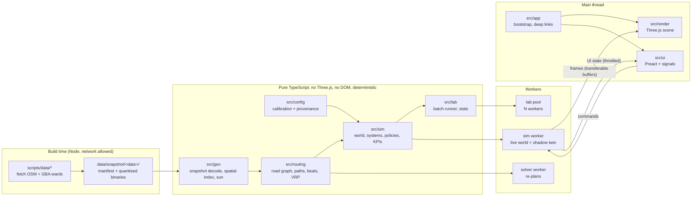

# Swachh Fleet World — Architecture

> Status: **APPROVED 2026-10-14** (Stage 2). **M1 complete and approved 2026-10-14**, including the §7 deviations.
> **M2 complete and approved 2026-10-14**, including the §8.11 deviations (DV-13 to DV-15). The fuel-KPI divisor
> question in §8.11 is resolved by M3-12 (per tonne collected). **Change requests CR-1 (no buildings drawn) and CR-2
> (floating 3D place labels)** are built and accepted 2026-10-14 (§9, results in §9.4).
> **M3 complete and approved 2026-10-14**, including the §10.10 deviations (DV-16 to DV-20).
> Implements `docs/requirements.md` (approved 2026-10-14). Data facts come from `docs/data-sources.md`.
> Decisions are numbered **AD-n**, and each one can be approved or changed separately.

## 1. Overview

The app is one offline HTML file. It has five layers with a strict dependency direction:



**Dependency rule (enforced in AD-2):** `config ← geo ← routing ← sim ← lab`. `render`, `ui` and `app` may import
the pure layers' **types** and pure helpers. The pure layers never import `three`, `preact`, DOM globals, `Date.now`,
`Math.random` or `performance.now`.

## 2. Architecture decisions

### AD-1 Stack and tooling
- **TypeScript 5.x strict** (`strict`, `noUncheckedIndexedAccess`, `exactOptionalPropertyTypes`, `noImplicitOverride`), **no `any`**.
- **Vite** with `vite-plugin-singlefile`. Workers are imported with `?worker&inline`, so they are inlined as blob URLs inside the single file.
- **Three.js** (rendering only), **Preact + @preact/signals** (UI).
- **Vitest** (unit, integration and `bench`), **fast-check** (property tests), **Playwright** (end-to-end against the built `dist/index.html` over `file://`).
- **ESLint** flat config with `typescript-eslint` `strictTypeChecked`, plus Prettier.
- Node 24 LTS. Exact dependency versions are pinned in `package.json` and the committed lockfile. Runtime dependencies are kept to three (`three`, `preact`, `@preact/signals`). Charts are hand-written SVG and validation is hand-written, so there is no chart or schema library.
- Build-time-only dependencies for scripts: `tsx` (to run TS scripts), `proj4` (UTM 43N projection), `@xmldom/xmldom` (to parse the GBA KML). None of them ship in the bundle.
- **Git:** initialised in Stage 3 (2026-10-14), using Conventional Commits.

### AD-2 Module boundaries are enforced, not just documented
- ESLint `no-restricted-imports` and `no-restricted-globals` overrides for `src/{config,geo,routing,sim,lab}/**` ban `three`, `preact*`, `window`, `document`, `Date`, `Math.random` and `performance`.
- A Vitest **architecture test** scans the import graph of the pure folders and fails if any of them reaches a banned module, even through a re-export.
- The pure layers use their own `tsconfig.pure.json` with `"lib": ["ES2022"]` (no `DOM` lib), so DOM types don't even compile there.

### AD-3 Map data pipeline (`scripts/data/`)
`npm run data:fetch` is run by hand and never by the build. It writes `data/snapshot/<YYYY-MM-DD>/`:

| Step | Detail |
|---|---|
| 1. Wards | Download the OpenCity GBA final ward KML (Dec 2025). Keep the 7 cluster wards (config list of `corporation + ward_id`). Cross-check names and numbers against the OSM `admin_level=10` relations, and warn on any mismatch. Extract `TOT_P`. |
| 2. Clip area | Union of the 7 ward polygons plus a **300 m buffer** (streets just outside a ward boundary are still driven), plus a corridor to KCDC (it is already inside ward 69). |
| 3. OSM fetch | Overpass bounding-box queries **in 4 tiles** (area queries time out on public servers, as seen on 2026-10-14). Each tile tries the main server, then the mirrors, with exponential backoff and a polite User-Agent. The raw responses are cached in `.cache/` (git-ignored) so re-runs are offline. |
| 4. Process | Project to UTM 43N (`proj4`), then subtract a fixed local origin (the cluster centroid), so all app coordinates are local metres (x east, y north). Clip to the area. Build the road graph: split ways at junctions, keep `highway` class, `oneway`, `lanes`, `maxspeed`, `name`. Simplify building footprints (Douglas–Peucker, 0.5 m), drop footprints under 12 m², keep `building`, `building:levels`, `height`. Collect water, parks, `amenity=marketplace`, `shop=*` densities, recycling centres and named places. |
| 5. Encode | Coordinates **quantised to 0.25 m in Int16** (±8.19 km range, enough for the ~6 km cluster) and delta-encoded per ring or polyline. Separate files: `roads.bin`, `buildings.bin`, `areas.bin`, plus `wards.json`, `pois.json`. |
| 6. Manifest | `manifest.json`: fetch date, endpoints used, the exact Overpass query texts, bounding boxes, the origin (UTM easting/northing), object counts, a **coverage report** (share of buildings with levels, wards with sparse footprints) and the **SHA-256 of every file**. |

**Expected size:** ~15k buildings × ~8 vertices × 4 B ≈ 0.5 MB, plus roads ≈ 0.4 MB, plus areas ≈ 0.1 MB, so about
**1–1.5 MB after base64**. That is well inside the 15 MB budget (N-1), which resolves risk R-1 without shrinking
the area.

The app imports the snapshot's binaries as base64 strings, which the single-file build inlines. `src/geo/snapshot.ts`
decodes them into typed arrays. P-3: a test recomputes the hashes and compares them with the manifest, so any
hand-edit fails CI.

### AD-4 Coordinates and the sun
- World space is **local metres** in a right-handed frame: x east, y north in the pure layers. The renderer maps this to Three.js (x, −z) with y up. One conversion function is unit-tested.
- The app ships only the origin and a tiny inverse transverse-Mercator function, tested against `proj4` reference points within 1 cm. It turns local metres back into lat/lon for the sun model and, in M5, for imported GPS tracks.
- **Sun position and sunrise/sunset** use the NOAA solar-position algorithm, as a pure function in `src/geo/sun.ts`, checked against published Bengaluru sunrise times for 4 dates (± 2 min).

### AD-5 Simulation core (`src/sim/`)
- **Fixed timestep `dt = 1 s` of simulated time.** The live view advances `speed × realDelta` worth of steps per frame (60× ≈ 60 steps per second, 240× ≈ 240). The step count per frame is capped, so a slow device slows simulated time instead of stuttering.
- **The clock is integer seconds since the scenario's start date at 00:00 IST.** IST is fixed at UTC+5:30 with no DST, so the clock needs no timezone library.
- **Seeded randomness with named streams.** A `xoshiro128**` generator is seeded per stream by hashing `(runSeed, streamName)`: `generation`, `sensors`, `absence`, `breakdown`, `compliance`, `blackspots`, `weather`, `traffic`. Adding a random draw in one system never shifts another system's numbers. Because the live world and the shadow twin share stream seeds, they face the **same** absences, breakdowns and waste. This is the *common random numbers* technique, and it makes KPI deltas reflect the policy rather than the luck of the draw.
- **World state** is plain typed objects in id-indexed arrays (`vehicles[]`, `bins[]`, `segments[]`, `blackSpots[]`, `transferPoints[]`, `facilities[]`), with no classes holding hidden state. It serialises with `structuredClone` for snapshot tests.
- **Systems run in a fixed order each step:** clock → weather → traffic field → generation (lazy) → sensors (every 900 s) → planner hooks (05:00 cut-off, 05:30 publish, incidents) → vehicle behaviour state machines → movement and lane queues → service, tipping, weighing → KCDC intake and diversion → black spots → KPIs → events and alerts.
- **Generation is lazy and analytic.** Each segment and bin stores `(lastServicedAt, accumulatedAtService)`. The current amount is the integral of its daily generation curve × weather and festival multipliers, evaluated in closed form on demand. Nothing ticks for the ~6k segments, and identical results are cheap.
- **Truth vs observation (credibility, R-4).** The sim keeps the **true** fill. Policies receive only an `Observation` (sensor readings with noise, stale or offline sensors, fleet roster, published traffic forecast). The planner function's type has no path to truth, so the dynamic policy cannot cheat.
- **Vehicle behaviour** is an explicit state machine per vehicle type (table in §4). Transitions emit typed events (`StopServed`, `StopSkipped`, `Tipped`, `Weighed`, `Diverted`, `BrokenDown`, …). The UI's process tracker, alerts and KPIs are all computed from this one event stream.
- **Determinism contract:** for the same seed and the same `ScenarioSpec`, the event stream and the final-state hash are identical on the same JS engine. Determinism across browsers isn't promised, because trig results can differ in the last bit. Simulation decisions avoid trig wherever possible.

### AD-6 Movement, traffic and "nothing ever overlaps" (L-4)
There are two tiers:

1. **Fleet vehicles (in the sim, deterministic).** Movement is microscopic along graph edges with **lane queues**: each directed edge has `lanes` FIFO queues. A vehicle keeps a minimum gap (vehicle length + 2 m) behind its leader (a simple Gipps-style speed rule). At junctions, a node **reservation** lets one vehicle at a time hold a junction's conflict area. Priority goes by road class, then arrival time, then vehicle id, so ties break deterministically. A vehicle may not enter an edge whose tail has no room ("don't block the box"), which prevents gridlock. A vehicle stopped for door-to-door service on a two-way street can be passed after a 3 s delay. On a single-lane one-way street, vehicles queue behind it.
2. **Background traffic (macroscopic in the sim, microscopic only in the view).** The sim holds a **density field** per edge from the TomTom-calibrated time-of-day curve × road class × weather, and the field sets fleet vehicle speeds. The renderer spawns visual cars, buses, two-wheelers and autos **only near the camera**, sized to that density. They follow the same gap and junction rules, with fleet vehicles as fixed leaders they must yield to. Visual cars never feed back into the sim, which keeps the sim deterministic and cheap while nothing on screen overlaps.

A property test drives random scenarios and asserts that no two fleet vehicles on the same lane are ever closer than
the minimum gap, and that every junction reservation is released.

### AD-7 Routing (`src/routing/`)
| Part | Design |
|---|---|
| **Road graph** | Compressed sparse row (CSR) adjacency in typed arrays. Directed edges respect `oneway`. Per-edge length, class, lanes and free speed. ~15–20k edges. |
| **Travel time** | Piecewise-constant per **15-minute bucket**: edge time = length ÷ (free speed × class factor × time-of-day factor × weather factor). Plans use the bucket at the planned departure time. Closed edges (waterlogging) have infinite time. |
| **Shortest paths** | Dijkstra with a binary heap. A* (heuristic: straight-line distance ÷ max speed) for point-to-point queries. Many-to-many matrices come from one Dijkstra per source, cached per (bucket, closure set). Contraction hierarchies are deferred unless N-9 fails. |
| **Beats (auto-tippers, arc routing)** | Door-to-door service is **arc routing**: the work is on streets, not points. (1) **Partition** the residential and service segments into *k* contiguous beats of about 1,000 households each (weight = household share by building footprint area × levels). The method is seeded region-growing on the graph, then boundary swaps to balance, and it is deterministic. (2) **Order** each beat's segments as a covering walk: greedy nearest unserved segment with shortest-path connectors, then 2-opt on the segment sequence. One pass serves both sides of a street. |
| **Node VRP (CVRPTW)** | Used for compactor runs (transfer points ↔ KCDC/landfill), market and commercial smart-bin pickups, and black-spot clearance crews. Construction by **Solomon I1 insertion**, then **local search** (relocate, exchange, 2-opt within a route, 2-opt* between routes) with an **iteration budget, not a wall-clock budget**, so results are deterministic. Ties break by stop id. |
| **Static policy** | Beats and compactor schedules are generated once from the network for the default fleet and frozen. Absent vehicles leave their beats unserved (this is today's practice, and it is what makes black spots form). |
| **Dynamic policy** | **05:00 data cut-off → solver worker → plan takes effect at 05:30.** Steps: forecast each bin's and segment's fill at its likely service time (an exponentially smoothed daily profile from observations); choose the required stops (≥ threshold, black-spot risk, the **48 h fairness guard** R-5); re-balance beats across the tippers actually present (absent beats are split among neighbours); solve the node VRP. Incident re-plans (breakdown, closure, new black spot) use the same pattern with a fixed 5-minute sim delay, and they re-plan only the affected routes. |
| **Objective (R-3)** | Lexicographic via weights: overflow-hours and missed black spots ≫ fuel ≫ km. Hard constraints: payload, shift length, transfer-point and KCDC capacity. |
| **Explainability (R-4)** | Every planned stop carries a `reason` (`predictedFill`, `backlogHours`, `blackSpotRisk`, `fairness`). Every dropped candidate carries a `dropReason`. Both appear in the detail panel. |

**Why the result waits for the plan time:** the sim worker sends the 05:00 inputs to the solver worker and keeps
simulating. At 05:30 sim time it applies the plan, and if the solver hasn't answered it **holds the sim clock**
until it does. The result depends only on the 05:00 inputs, so it's deterministic however fast the device is. The
view never freezes (N-9), and tests run the solver inline.

### AD-8 Threads and hosts
- **`SimHost` interface** with two implementations. `WorkerSimHost` (default) and `InlineSimHost` (used by tests, and as a fallback if creating a blob worker from `file://` fails in some browser). Both expose the same typed command and message protocol.
- **Sim worker:** runs the live world **and the shadow twin** (D8) in lockstep, as two independent `World` instances with the same streams. The twin is never rendered. It only feeds KPI deltas.
- **Frames to the view:** after each batch of steps the worker posts a `Frame` carrying a transferable `Float32Array` (per vehicle: x, y, heading, speed, state code, load fraction), the sim time, and any events since the last frame. The renderer keeps the last two frames and **interpolates** at display rate (L-5).
- **UI state:** a separate, throttled message (≤ 4 Hz) carries KPI values and deltas, table rows and alerts into Preact signals. Tables refresh at ≤ 2 Hz.
- **Commands:** `setSpeed`, `pause`, `step`, `skipToMorning`, `setWeather`, `setPolicy`, `applyScenario`, `select(id)` (asks for detailed live state of one object at 4 Hz). All are validated in the worker.
- **Lab pool:** `navigator.hardwareConcurrency − 1` workers (min 1, max 6), each running whole `(spec, seed)` jobs headless with no frames. Results stream back per simulated day.

### AD-9 Calibration config and provenance (P-1 to P-5)
- `src/config/sources.ts` is the registry of `SourceId`s (e.g. `bswml-dh-5500tpd`, `tomtom-2025`, `gba-wards-dec2025`, `osm-snapshot`).
- `src/config/calibration.ts` holds typed figures:
  ```ts
  type Tag = 'real' | 'derived' | 'assumed' | 'synthetic';
  interface Figure<T = number> { readonly value: T; readonly unit: Unit; readonly tag: Tag;
    readonly sourceIds: readonly SourceId[]; readonly asOf: IsoDate; readonly note?: string;
    readonly alternatives?: readonly Figure<T>[] }   // P-4 conflicting values
  ```
- **Derived values are computed, never typed in.** `derive(fn, inputs)` returns a `derived` figure whose `sourceIds` are the union of its inputs'. The W-5 table (population → households → waste → fleet → black spots) is one function of the config, with unit tests.
- **Doc sync test:** Vitest parses `docs/data-sources.md` and fails if any `SourceId` in code is missing from the doc, or if a figure's tag differs from the doc's tag for that source.
- **UI rule (P-2):** every number the UI shows goes through one `<Fig>` component that renders the value, the unit and a tag badge with a tooltip (source and date). Simulated values always show "Simulated". A lint rule bans rendering raw numbers from sim state outside `<Fig>`, via a typed `Provenanced<number>` wrapper.

### AD-10 Rendering (`src/render/`)
| Concern | Design | Draw calls (laptop) |
|---|---|---|
| Buildings | **Not drawn since CR-1 (§9.1)**; the rest of this row is history. Footprints extruded **in a worker at load time** into merged geometry per **1 km tile × material** (31 tiles; DV-13). Low-poly clay material, flat roofs, height from levels or else `assumed` by type and footprint area. Tiles are frustum-culled. The low tier drops the smallest buildings and shadows. | ≤ 60 |
| Roads | Ribbon meshes merged per class (4 classes), with lane markings as a texture in the material. Wet-road reflections come from a roughness and envmap swap in the monsoon. | 6 |
| Ground, water, parks, ward outlines | Merged meshes and one line mesh for wards. | 6 |
| Agents | One `InstancedMesh` per vehicle type (6), bins (by fill colour through instance colour), people, and visual traffic (4 types). | ~15 |
| Facilities | Distinct low-poly models: KCDC, weighbridge, depot, DWCC, transfer points. | ~10 |
| Effects | Rain (instanced streaks), haze (fog), selection ring, route line, trails. | ~6 |

- **Total budget:** under 110 on laptops, under 80 on phones, which leaves headroom under N-2's 200 / 120.
- **Lighting:** one directional sun driven by AD-4 plus hemisphere light. One shadow map fitted to the camera view (2048 on laptop, 1024 on phone, off on the low tier). At night, emissive windows and street lights come from an instanced emissive pass instead of real lights.
- **Quality tiers** (auto-detected from GPU and device memory, overridable): `high` / `medium` / `low`.
- **Picking:** CPU raycast against a spatial hash of agent and facility positions, not mesh raycasts. Clicks under 5 ms.
- **Labels:** one HTML overlay element for the selected object, projected each frame. No per-object DOM.
- **Time scale vs distance (R-3), decision:** short **motion trails** appear at ≥ 120×. **Following a vehicle caps speed at 30×** while following, with a visible "Follow · 30×" badge, and speed returns to the previous value when follow ends.
- `prefers-reduced-motion` turns off eased camera glides (cuts instead), rain streaks and trails.

### AD-11 UI (`src/ui/`)
- Preact components over signals. One `store.ts` maps worker messages to signals, and components never talk to the worker directly (a `commands.ts` façade does).
- The layout follows requirements D-1 to D-9. On phones, panels collapse into a bottom sheet (X-3).
- **Tables** are sorted and filtered in memory. Rows are capped at ~300 (bins 120, fleet ~70, routes ~70), so no virtualisation is needed.
- **Lab charts** are hand-written SVG (bar plus whisker, line with band), each paired with a `<table>` (N-5).
- **Theme:** CSS custom properties. The light/dark choice lives in `localStorage` with try/catch, and failure falls back to dark (X-4).
- **Accessibility:** every panel is reachable by keyboard, focus is visible, and alerts use an `aria-live="polite"` region. The accent #22A86B is used for text only where it passes AA (in dark mode). In light mode it is used only for fills and icons.

### AD-12 Scenarios, deep links and the lab (§7)
- **`ScenarioSpec`** is a plain, versioned JSON object: `{ v: 1, seed, startDate, days, weather, policy, levers: {...}, presetId? }`. A hand-written validator **clamps every lever to its documented range** and rejects unknown keys.
- **Deep link (SC-4):** `#s=<base64url(JSON)>`, capped at 4 KB, decoded only through the validator. Invalid links open the default world with a toast.
- **Lab:** N days × M seeds × 2 configs, spread across the pool. Per-day KPI records are aggregated into mean, standard deviation and a 95% interval across seeds. The ~20% Mumbai figure appears only as a labelled external reference (SC-2).
- **Export (SC-3):** CSV (Blob download) and a printable one-page summary (a print stylesheet on a summary view) listing the spec, the assumptions and every figure's provenance.

### AD-13 Security and privacy
| Risk | Control |
|---|---|
| Runtime network calls (N-6) | A **Content-Security-Policy** meta tag in the built file: `default-src 'none'; script-src 'unsafe-inline' blob:; worker-src blob:; style-src 'unsafe-inline'; img-src data: blob:; font-src data:; connect-src 'none'`. With `connect-src 'none'` the page *cannot* fetch anything, and a Playwright test asserts zero network requests. |
| Untrusted input (deep links now; CSV/JSON import in M5) | Schema validation with size caps (deep link 4 KB, imports 25 MB), numeric clamping, no `eval`/`Function`, no `innerHTML` (Preact escapes text). CSV parsing guards against formula injection on **export** (cells starting with `= + - @` get a leading `'`). |
| Supply chain | Few runtime dependencies (AD-1), a pinned lockfile, `npm audit --omit=dev` in CI, no post-install scripts from new dependencies without review. |
| Data scripts | Run only by hand. Responses are checked (JSON shape, counts within expected ranges) before writing. The snapshot is reviewed in the PR diff (manifest counts). |
| Credibility / misuse (R-5) | Permanent disclaimer (P-5), provenance on every figure, assumptions printed on every export. No logos (N-7). |
| Personal data | None: synthetic IDs only, no plates or names, no telemetry. Imported files stay in memory (IM-2). |

### AD-14 Performance budgets and how they're checked
| Budget | Target | Check |
|---|---|---|
| File size (N-1) | ≤ 15 MB (expected ~3 MB) | Build step fails above the budget |
| Load to first frame | ≤ 4 s on a mid-range laptop | Playwright timing (soft gate) |
| Frame rate (N-2) | 60 fps laptop / ≥ 30 fps phone | Manual check on reference devices plus an in-app FPS overlay (`?debug=1`). CI can't measure GPU fps reliably |
| Draw calls (N-2) | ≤ 200 / ≤ 120 | Playwright reads `renderer.info` via the debug hook and asserts the budget |
| Sim speed | 1 simulated day (live + twin) ≤ 1.5 s headless in Node | `vitest bench` gate |
| Dynamic re-plan (N-9) | ≤ 2 s for the whole cluster | `vitest bench` gate on the solver with the real snapshot |
| Lab | 7 days × 10 seeds × 2 configs ≤ 60 s on 4 workers | Bench (soft gate) |

## 3. Repository layout

Files marked † exist from Stage 3 of M1 (stubs or tests); the rest arrive in later stages and milestones.

```
Swachh-Fleet-World/
├─ CLAUDE.md
├─ docs/                     requirements · architecture · data-sources · (later) import schemas
├─ scripts/data/             fetch-snapshot.ts† · lib/ (overpass.ts†, simplify.ts†, kml.ts†, encode)
├─ data/snapshot/2026-10-xx/ manifest.json · roads.bin · buildings.bin · areas.bin · wards.json · pois.json
├─ src/
│  ├─ shared/   civil.ts · utf8.ts · rng.ts (the Stage 3 not-implemented placeholder is gone)
│  ├─ config/   sources.ts† · calibration.ts† · derive.ts† · scenario.ts† · (M4) scenario validation
│  ├─ geo/      quantise.ts† · snapshot.ts† · project.ts† · spatial-hash.ts† · sun.ts†
│  ├─ routing/  graph.ts† · travel-time.ts† · dijkstra.ts† · beats.ts† · heap.ts · scc.ts · geometry.ts · (M3) vrp/ · explain.ts
│  ├─ sim/      rng.ts† · clock.ts† · generation.ts† · sensors.ts† · observation.ts† · events.ts† · kpi.ts† ·
│  │            agents/ (fsm, tipper, compactor, black-spot, crew)† · movement/traffic.ts† · map-data.ts† ·
│  │            world.ts† · world-config.ts† · naming.ts · (M3) policies/dynamic.ts
│  ├─ lab/      (M4) runner.ts · stats.ts · export.ts
│  ├─ workers/  engine.ts · sim.worker.ts · protocol.ts · host.ts · (M3) solver.worker.ts · (M4) lab.worker.ts
│  ├─ render/   coords.ts† · scene.ts · map-meshes.ts · agents.ts · bg-traffic.ts · palette.ts
│  ├─ ui/       App.tsx (TopBar, DetailPanel, Footer) · store.ts · format.ts · styles.css · (M2) KPI cards, tracker, tables, alerts, Data sources
│  └─ app/      main.ts† · boot.tsx · debug-api.ts† · snapshot-data.ts · webgl-check.ts · (M5) deeplink.ts
├─ tests/
│  ├─ fixtures/     grid.ts† · town.ts†
│  ├─ unit/         config† · geo† · routing† · sim† (+ agents†) · render† · scripts†
│  ├─ property/     dijkstra† · beats† · lanes† · (M3) vrp
│  ├─ integration/  day.test.ts†
│  ├─ arch/         boundaries† · provenance-docs† · snapshot-integrity†
│  ├─ perf/         sim-day.perf.test.ts† · (M3) replan.perf.test.ts
│  └─ e2e/          helpers.ts† · offline.spec.ts† · interaction.spec.ts† · (M4) lab.spec.ts
└─ index.html† · vite.config.ts† · vitest.perf.config.ts† · tsconfig.json† · tsconfig.pure.json† · eslint.config.js† · playwright.config.ts† · package.json†
```

npm scripts: `dev`, `build`, `preview`, `lint`, `typecheck` (both tsconfigs), `test` (unit, property, arch,
integration), `test:perf`, `test:e2e`, `data:fetch`, `check` (= lint + typecheck + test).

## 4. Key state machines

| Agent | States (→ transitions on events) |
|---|---|
| Auto-tipper | `OffShift` → `ToBeat` → `Serving(segment)` ⇄ `Driving` → `ToTransfer` (when full or the beat is done) → `Tipping` → back to `ToBeat`, or `ToDepot` → `OffShift`. Side states: `Absent` (whole day), `BrokenDown` (until repair), `Deviating` (non-compliance; geofence emits `RouteDeviation`) |
| Compactor | `OffShift` → `ToTransferPoint` → `Queued` → `Loading` → (full or scheduled) `ToKCDC` → `Weighing` → `Unloading` → next run, or `ToLandfill` (KCDC at cap) → `Unloading` → back |
| Clearance crew | `Idle` → `ToBlackSpot` → `Clearing` (duration ∝ spot size) → `ToKCDC/Landfill` → `Idle` |
| Smart bin | Fill rises continuously. Sensor `Ok` / `Stuck` / `Offline`. A `Serviced` event resets it |
| Black spot | `Dormant` → `Active(size grows)` → `Clearing` → `Dormant`. Activation chance rises with backlog and skips nearby |
| KCDC | Intake counter per day. At the cap, new arrivals are told to divert (event `Diverted`) |

## 5. Test strategy (what Stage 3 writes first)

Stage 3 writes failing tests **for M1 only**. Each later milestone gets its own Stage 3–4 loop under this architecture.

| Suite | First failing tests (M1) |
|---|---|
| `arch/boundaries` | The pure folders import nothing banned |
| `arch/provenance-docs` | Every `SourceId` exists in `data-sources.md` with a matching tag |
| `arch/snapshot-integrity` | Manifest hashes match the files. Counts are within expected ranges |
| `unit/config` | W-5 derivations (population → households → waste → fleet → black spots) give the expected numbers and tags |
| `unit/geo` | Quantise/decode round-trip ≤ 0.125 m error. Inverse projection within 1 cm of `proj4` points. Sunrise and sunset for Bengaluru within 2 min on 4 dates. Spatial hash queries |
| `unit/sim` | RNG streams are independent and reproducible. IST clock formatting. Lazy generation equals step-wise integration. Each state machine's transitions. Event stream. KPI formulas K-1 to K-3 on hand-built worlds |
| `property/*` | Beats: contiguous, every segment in exactly one beat, household balance within ±15%. Lanes: no gap violations, reservations always released, no deadlock in random grids. RNG: uniformity smoke test |
| `unit/routing` | CSR graph from a tiny fixture respects one-ways. Dijkstra and A* match brute force. Time buckets. Closed edges |
| `integration/day` | **Golden determinism:** a seeded static-policy day on a small fixture town gives a fixed event-stream hash. Same seed twice gives identical results. A different seed gives a different result |
| `e2e/offline` | `dist/index.html` opened over `file://` renders a canvas, makes **zero** network requests, shows the OSM attribution and the disclaimer, and shows the WebGL-missing message when WebGL is disabled |
| `e2e/interaction` | Clicking a vehicle selects it (ring, label, panel), and Esc clears the selection |
| `perf/sim-day` | One headless day ≤ 1.5 s (gate) |

VRP tests (known optima on small instances, and property tests for capacity, time windows and each stop served
exactly once) are written in M3's Stage 3.

### 5.1 M1 Stage 3 result (2026-10-14)

**Method.** Every public M1 function exists as a typed stub with its contract in its doc comment. Each stub throws
`NotImplementedError` (`src/shared/not-implemented.ts`), so the tests compile and fail for that one reason. Lint and
both typechecks pass.

| Command | Result |
|---|---|
| `npm run lint`, `npm run typecheck` | Clean |
| `npm test` (unit, property, arch, integration) | **301 tests: 292 fail, 9 pass.** Every failure traces to a stub. The 9 passes are guards that already hold: boundaries (3), the Source IDs table matching the code (3), the type-level truth/observation split (2), and `SpatialHash` rejecting a zero cell size (1) |
| `npm run test:perf` | 1 test, fails (stubs) |
| `npm run test:e2e` (Chromium) | **13 tests: 11 fail, 2 pass.** The 2 passes check the build set-up done in this stage (one `index.html` within budget; CSP with `connect-src 'none'`). Firefox and WebKit need `npx playwright install firefox webkit` |

**Contracts the tests pin down** (beyond §2), so Stage 4 has no guesswork:
- **Fixtures:** `tests/fixtures/grid.ts` is a block grid with every block a separate way. `tests/fixtures/town.ts` is a 6 × 6 town with 60 segments × 60 households, 4 tippers, 2 compactors, 1 crew, 4 market bins and 2 black spots.
- **W-5 formulas** (`deriveClusterScale`): fleets round up, households and black spots round to nearest, and `derivedFrom` is transitive. A fixture calibration gives 156,598 → 250,557 people → 64,245 households → 65 tippers, 98.4 t/day → 6 compactors, 28 black spots.
- **Sun:** published timeanddate.com times for Bengaluru on 1 Mar, 20 Mar, 14 Oct and 21 Dec 2026 (±2 min), and noon altitudes (±0.5°).
- **RNG:** the xoshiro128** reference vector for state [1, 2, 3, 4], independent named streams (including a `layout` stream for map placement), and a chi-square smoke test.
- **Sim time:** a step from t to t+1 emits events stamped t+1. Sensor readings fall at every multiple of 900 s, 96 a day.
- **Speed model:** factor 1 from 23:00 to 05:00, rush-window means equal TomTom ÷ 30 km/h, and adjacent buckets differ by ≤ 0.15.
- **Lane queues:** no same-lane gap violation, a junction reservation held ≤ 60 s, and every vehicle arrives within 120 s + 3 × free-flow time + 600 s on random grids.
- **Beats:** ±15% balance when no segment exceeds 5% of the target, and a walk ≤ 2.5 × the beat's street length on grids.
- **Debug hook** (`src/app/debug-api.ts`, only with `?debug=1`): `ready`, `drawCalls()`, `skipTo()`, `vehicleIds()`, `screenPositionOf()`, `emptyGroundPoint()`, `selectedId()`.
- **The golden event-stream hash** (`integration/day`) is recorded on the first green run and changes only deliberately (`vitest -u`).

### 5.2 M1 Stage 4 result (2026-10-14)

| Check | Result |
|---|---|
| `npm run lint`, `npm run typecheck` | Clean |
| `npm test` (unit, property, arch, integration) | **337 passed.** That is the 301 Stage 3 tests plus 36 added in Stage 4 for modules the implementation introduced (lane geometry, display ids, multipolygon stitching, route stops and rerouting, binary and heap codecs, map-building fallbacks, render agent updates) and for world paths the Stage 3 town never reached (breakdowns, non-compliance, black-spot clearance, monsoon, a tipper filling mid-beat, KCDC hitting its cap part-way). These were written after the code, not before |
| Coverage (`vitest --coverage`) | 95.3% statements, 85.0% branches, 97.0% functions, 97.5% lines (thresholds 90/85/90/90) |
| `npm run test:perf` | Passes: one real-cluster day of live world + shadow twin within 1.5 s (~0.4 s per world-day measured) |
| `npm run test:e2e` | **39 passed** (13 tests × Chromium, Firefox, WebKit) over `file://` |
| Build | One `dist/index.html`, **2.26 MB** (budget 15 MB), ready in ~1.4 s, **105 draw calls** at the overview (budget 200) |

**Real-cluster sanity run** (static policy, 5% absence, 2% skips, two days): 65 auto-tippers, 6 compactors and 2 crews
on a 5,464-node, 13,032-edge core network; 4,395 served street segments; about 104.7 t generated a day. Day 2: about
93% of segments served, about 97 t collected, about 89 t delivered to KCDC, a 6.7 t backlog at transfer points, and every
vehicle ends the day off shift. (The static baseline collects more than the 2023 "< 60%" city figure; see §7.)

## 6. Risks after this design

| # | Risk | Status |
|---|---|---|
| R-1 | Snapshot size | **Resolved by measurement:** ~1–1.5 MB expected (AD-3). |
| R-2 | OSM gaps (heights 1.7% tagged; possible footprint gaps) | Mitigated. Heights `assumed` by rule. The coverage report shows sparse wards in the Data sources dialog. Nothing is invented. |
| R-3 | Time scale vs real distances | Decided: trails ≥ 120× and follow caps at 30× (AD-10). |
| R-4 | Solver credibility | Mitigated. Truth vs observation split (AD-5), sensor noise and forecast error on, common random numbers, multi-seed lab. |
| R-5 | Results quoted as real | Mitigated (AD-13). |
| R-6 *(new)* | Blob workers from `file://` could be blocked in some browser | `InlineSimHost` fallback (AD-8), and Playwright runs on Chromium, Firefox and WebKit. |
| R-7 *(new)* | Public Overpass servers are unreliable (seen 2026-10-14) | Tiled bbox queries, mirrors, backoff, local cache (AD-3). The snapshot is committed, so this only affects re-fetches. |
| R-8 *(new)* | 2026 population projection | The growth factor is `assumed` until sourced in M1. It is a single config lever, and the UI labels it. |

## 7. M1 implementation notes and deviations (Stage 4, 2026-10-14)

These are the places where the build differs from §2, or adds a decision §2 did not make. Each needs your approval or
a change request.

| # | Area | What was built | Versus the design |
|---|---|---|---|
| DV-1 | AD-7 static plan | **Each beat hands over at a fixed transfer point** (the one nearest its household centre), and **compactors are allocated to transfer points by expected tonnage** (at least one each, the rest by largest remainder). Each compactor shuttles to its home transfer point on fixed slots (09:30, 12:00, 14:30, 17:00). | New decision. The first attempt (tip at the nearest point, compactors rotating across all points) left about 81 t piled up at two points by day 2. |
| DV-2 | Transfer-point sites | Placed by **household-weighted k-means** over served streets, snapped to free main-road nodes (`assumed`, "Location assumed"). | New decision. Farthest-point placement put them at the cluster's edges. |
| DV-3 | AD-7 beat walks | Greedy nearest-unserved-segment covering walk. **No 2-opt pass yet.** | Deferred to M3, where route quality matters for the static-vs-dynamic comparison. The ≤ 2.5 × street-length guard already passes. |
| DV-4 | Map service area | Service, facilities and bins are limited to the **largest strongly connected part** of the road network, so every stop can be reached and left. Streets outside it are drawn but not served. | New detail. |
| DV-5 | Day-1 stock | A run starts with **no waste on the streets at 00:00**, so day 1 collects less than later days. | Simplification required by the approved "≈ one day generated" test. Steady state is reached from day 2. |
| DV-6 | AD-6 background traffic | Cars, two-wheelers, autos and buses run on main roads in their own lane-queue model (no overlaps among themselves). A background vehicle within 7 m of a fleet vehicle **is not drawn that frame**. | The design said background vehicles yield to fleet vehicles. Hiding gives the same "nothing overlaps" result more cheaply. True yielding could come in M2 if it looks wrong. |
| DV-7 | AD-8 shadow twin | The live engine runs **only the live world** in M1. | The twin feeds the KPI deltas, which are M2, so it joins the engine then. The perf gate already runs live + twin. |
| DV-8 | AD-10 build-out | Building geometry is built **on the main thread** at load (about 1 s on a laptop). **Motion trails at ≥ 120× are not built yet.** The follow cap at 30× is built. | Trails and worker-side geometry move to M2. |
| DV-9 | Lighting | The sun direction follows the real sun for the simulated date, with a daylight floor so the world reads before sunrise. | Night lighting (X-2) is M2. |
| DV-10 | Driving side | Vehicles are drawn **left of the centre line** (India keeps left); one-way lanes are centred. | Detail the design did not state. |
| DV-11 | Lint | `@typescript-eslint/no-non-null-assertion` is off (see AD-1). | Needed for numeric code under `noUncheckedIndexedAccess`. |
| DV-12 | Calibration gap | The static baseline serves about 93% of street segments a day. The 2023 B.PAC figure is "< 60% collected" city-wide. | Not yet calibrated: absence, skip and breakdown rates and black-spot dumping are defaults. Calibrating the baseline against real figures belongs with the scenario work (M3/M4) and should happen before any static-vs-dynamic result is shown. |

The new operating assumptions (payloads, service times, slots, fuel rates, lane width and others) are listed in
`docs/data-sources.md` under "Assumptions log".

## 8. M2 design addendum: Dashboard and Extras (approved 2026-10-14)

M2 implements requirements D-1 to D-9 and X-1 to X-4. It also picks up three items deferred from M1: the shadow twin
in the live engine (DV-7), motion trails at 120× and above (DV-8), and building geometry in a worker (DV-8). Decisions
are numbered **M2-n**.

### 8.1 KPIs (D-3, K-1 to K-3)
**M2-1.** The world keeps today's KPI accumulators and resets them at 00:00 IST. `worldKpis(world)` returns:

| KPI | Definition used |
|---|---|
| **Overflowing points** | Smart bins at a true fill of 100% or more (**90% in a heatwave**), plus black spots that are Active or Clearing, sampled now. **Overflow-hours today** is integrated at each 15-minute sensor round (full bins × 0.25 h). |
| **Fuel per tonne** | Fleet litres today ÷ tonnes unloaded today (KCDC plus landfill). ₹ = litres × the diesel price, a new `assumed` calibration figure (`dieselPriceInrPerL`, ₹89/L, to source). Null before the first delivery. |
| **On-time coverage** | Jobs scheduled today and served inside their window ÷ jobs scheduled today. A beat's street segments and its bins are scheduled at the tipper's shift start, with the shift as the window. A black spot that activates is a clearance job with a 24 h window. |
| Sub-lines | "Bins full n · Black spots n"; litres and ₹; "Collected t / generated t" today. |

**M2-2.** **Trend** is the last 24 hourly samples of each KPI, drawn as a sparkline. **Delta** compares the live world
with the shadow twin using `deltaVsTwin`.

### 8.2 Shadow twin (D8, DV-7)
**M2-3.** The engine runs a second `World` in lockstep: the **baseline**, which is the same seed, static routing,
clear weather and default levers. Only the live world takes the weather menu and, later, scenario levers. Because the
two share random streams (AD-5), the deltas isolate the effect of what you changed. The twin is never drawn.

### 8.3 Weather (X-1)
**M2-4.** `setWeather(world, mode)` changes the weather from the current instant. Generation multipliers apply only from
that moment on, so mass balance still holds.

| Mode | Simulation effect |
|---|---|
| Clear | Baseline |
| Monsoon downpour | Speeds × 0.7. Wet waste +15% by weight (+9% overall). **Flood-prone streets close** (M2-5). On entry, each sensor goes offline with a 3% chance. |
| Winter haze | Speeds × 0.9 from 05:00 to 09:00 |
| Heatwave | Overflow threshold 90% (M2-1). Black-spot activation pressure × 1.5. |

Visuals: rain streaks and wet roads (roughness and colour) in a monsoon, fog in haze, a warm grade in a heatwave.

**M2-5. Waterlogging spots (`assumed`).** No public list of waterlogging spots for the cluster was found. `buildMapData`
marks up to 12 **flood-prone spots**: road nodes within 120 m of a water area, chosen farthest-first so they spread
out. Every edge within 40 m of a spot closes in a monsoon (both directions). A `RoadClosed` / `RoadReopened` event
feeds the alerts. Closed edges cost Infinity when routes are planned. A tipper whose next segment is closed skips it
(`StopSkipped`, reason `road-closed`) and drives round. A vehicle already on a closed edge may leave it.

### 8.4 Day and night (X-2)
**M2-6.** Lighting comes from the sun's altitude: **day** above +6°, **twilight** from −6° to +6°, **night** below
−6°. At night, street lights (an instanced emissive pass along the main roads), vehicle headlights and lit windows (an
emissive tint on a deterministic share of building faces) switch on. The top bar's day/night toggle can force day or
night for viewing. That only affects the view, never the simulation.

**M2-7. Night clearance.** Clearance crews are dispatched **19:00–21:00** (it was 14:00–18:00 in M1), so black-spot
clearance happens after dark and still finishes before midnight.

### 8.5 Process tracker (D-5)
**M2-8. Lineage batches.** Every collection creates a batch {origin bin or segment, kg, collected at, vehicle}. Tipping
moves a tipper's batches into the transfer point's FIFO queue (transferred at). A compactor takes batches from the
front of the queue, splitting the last one if needed. Unloading stamps them processed (KCDC or landfill).

For a selected **bin**, the timeline of its latest batch shows **Fill reported** (the last sensor reading at or before routing,
so the steps stay in order), **Routed** (the shift start of the tipper whose beat includes it), **Vehicle en route** (that tipper reaching its beat), **Collected**,
**Transferred** and **Processed**. A selected **transfer point** shows its oldest waiting batch. A selected
**vehicle** shows the batches it is carrying. With nothing selected, the tracker shows **today's counts**: sensor
readings, stops planned, vehicles on the road now, stops served, tips and unloads.

### 8.6 Tables, alerts and search (D-6, D-8, D-2)
**M2-9. Tables**, refreshed at 2 Hz, sortable by any column and filterable by text, where clicking a row selects:

| Tab | Columns |
|---|---|
| Bins & points | ID, type, ward, fill % (sensor), predicted full at (linear fit of the last two rising readings, `synthetic`), last serviced, sensor status |
| Fleet | Vehicle ID, type, status, load kg, fuel L, km today, skipped stops |
| Routes | Route ID `R-<date>-<nnn>`, vehicle, stops done / planned, km planned (beat walk) vs actual, deviations, ETA (remaining walk ÷ 12 km/h + remaining service time) |

**M2-10. Alert rules** (de-duplicated, newest first, at most 200):

| Alert | Severity | Raised | Re-armed |
|---|---|---|---|
| Bin at 90% or more / overflowing (100%) | warning / critical | First reading at or above the threshold | After a reading below 50% |
| Black spot activated | warning | `BlackSpotActivated` | Each activation |
| Vehicle absent | warning | `VehicleAbsent` | Each day |
| Vehicle broken down | critical | `BrokenDown` | Each breakdown |
| Skipped stops | info | A vehicle's 3rd skip of the day | Each day |
| Route deviation | warning | `RouteDeviation` | Each event |
| KCDC at intake cap | critical | First `Diverted` of the day | Each day |
| Road closed by waterlogging | warning | `RoadClosed` | Each closure |
| Sensor offline | info | First offline reading | After an ok reading |

**M2-11. Search** covers vehicles, bins, black spots, facilities, streets (OSM way names; a hit flies to the street)
and wards (number or name). Matching ignores case. Ranking: exact id, then id or word prefix, then substring. At
most 8 results.

### 8.7 Data sources dialog (D-9), theme (X-4), mobile (X-3)
**M2-12.** The dialog lists every calibration figure (value, unit, tag, sources with links, date, note, and conflicting
alternatives), every derived figure (with what it is derived from), the OSM snapshot (fetch date, licence, counts,
coverage report) and the simulated streams (tagged Simulated). It is keyboard-operable and closes with Esc.

**M2-13.** Theme: dark by default, with a light toggle saved in `localStorage` under `kasaflow.theme`. Reading or
writing is wrapped in try/catch, and a failure falls back to dark silently. Light mode uses the accent only for fills
and icons (N-5).

**M2-14.** Below 720 px wide, the detail panel, tracker, tables and alerts become one bottom sheet with tabs. Touch:
one finger pans, two fingers pinch-zoom and rotate (MapControls touch mapping). The phone draw-call budget of 120 or
fewer is tested at a 390 × 844 viewport.

### 8.8 Protocol and performance
**M2-15.** New messages. `ToSim`: `setWeather`, `selectObject` (bin, transfer point or vehicle, for the tracker).
`FromSim`: `dashboard` at 2 Hz carrying KPIs (live, twin, delta, trend), table rows, new alerts, tracker data and step
counts. Row building runs in the worker. Trails are kept for the last 20 s of simulated movement per visible vehicle
at 120× and above.

**M2-16.** Building geometry moves to the sim worker (`buildBuildingBuffers` returns transferable typed arrays), so the
main thread only uploads it.

### 8.9 M2 failing tests (Stage 3)

| Suite | Tests |
|---|---|
| `integration/kpi-live` | Accumulators and daily reset; overflow-hours at sensor rounds; heatwave threshold; fuel per tonne null before delivery; coverage windows; ₹ from the diesel figure |
| `unit/sim/lineage` | Batches through collect → tip → FIFO load (with a split) → unload; latest batch per origin |
| `integration/tracker-tables` | Bin, transfer-point and vehicle timelines are ordered; today's step counts; bin, fleet and route rows |
| `unit/sim/alerts` | Every rule in M2-10, including de-duplication and re-arming |
| `unit/sim/forecast` | Predicted full-at from rising readings; null when flat or falling |
| `unit/routing/weather` | Speed models per weather mode (monsoon all day, haze 05:00–09:00 only) |
| `unit/sim/map-data` (added) | Flood-prone spots near water only, at most 12, both directions closed |
| `integration/weather` | Monsoon: closed segments are skipped (`road-closed`), no vehicle enters a closed edge, mass balance holds, generation +9% from the switch; haze slows the morning only; heatwave raises overflow |
| `integration/night` | Clearance dispatched 19:00–21:00 and crews idle by midnight |
| `unit/sim/data-source-rows` | Every calibration and derived figure appears with a valid tag and resolved sources; snapshot row with date and ODbL |
| `unit/ui/search`, `unit/ui/table`, `unit/ui/theme` | Ranking and limits; sort and filter; theme load, save and fallback when storage throws |
| `unit/render/lighting`, `unit/render/trails` | Day, twilight and night thresholds; trail ring buffer and the ≥ 120× switch |
| `integration/engine` (node, real snapshot) | Twin runs in lockstep; the dashboard message carries KPIs, deltas, tables (120 bins, 73 vehicles, 65 routes), alerts and the tracker; monsoon makes live differ from the twin |
| `e2e/dashboard` | KPI cards with values, deltas and trends; three table tabs, sorting, filtering, row click selects; alerts list and click-to-select; tracker with 6 steps and timestamps for a selected bin; search finds a ward, a vehicle and a street; Data sources dialog opens, lists tagged rows and the OSM date, and closes with Esc |
| `e2e/extras` | Weather menu switches mode (data attribute and a KPI delta appears); night after sunset (debug `lighting()`); day/night override; theme toggle survives a reload |
| `e2e/mobile` | 390 × 844 with touch: bottom sheet with details, tapping a vehicle selects, draw calls 120 or fewer |

### 8.10 M2 Stage 3 result (2026-10-14)

Typed stubs (calling `notImplemented`, which was back in `src/shared/` until M2 was built) cover every new API: the
world's weather, KPI, tracker and table functions; flood-spot finding; alerts; lineage; forecast; data-source rows;
the weather speed model; lighting; trails; search; table sort and filter; theme; and the engine's new messages. Two
data additions were made directly because they are configuration, not behaviour: the `dieselPriceInrPerL` calibration
figure (₹89/L, `assumed`) and the `RoadClosed` / `RoadReopened` event types.

| Command | Result |
|---|---|
| `npm run lint`, `npm run typecheck` | Clean |
| `npm test` | **408 tests: 339 pass, 69 fail.** All 337 M1 tests still pass. Of the 71 new tests, 69 fail: 64 on `NotImplementedError` and 5 on behaviour (no dashboard message yet, M1's 14:00 clearance window, no flood spots found). 2 pass already: the alert-severity table (data) and "rejects an unknown weather mode" (passes only because the engine stub errors on every weather message; it becomes a real check in Stage 4). |
| `npm run test:e2e` (Chromium) | M1's 13 tests still pass. The 6 dashboard and 5 extras tests fail (the elements do not exist yet). Of the 3 phone tests, the tabbed bottom sheet (M2-14) fails; the draw-call budget (≤ 120) and "details in a bottom sheet" already pass, because M1's layout already moves the panel down on narrow screens. |

### 8.11 M2 Stage 4 result (2026-10-14)

Everything in §8 is built: the shadow twin, KPIs with deltas and hourly sparklines, the process tracker, the three
live tables, the alert feed, search, the Data sources dialog, weather (monsoon closures, haze, heatwave), real day and
night lighting with the override toggle, night clearance, motion trails at 120× and above, building geometry built in
the worker, the light theme and the phone bottom sheet. The Stage 3 placeholder `src/shared/not-implemented.ts` is
deleted again.

| Command | Result |
|---|---|
| `npm run lint`, `npm run typecheck` | Clean |
| `npm test` | **408 passed** (58 files) |
| Coverage (`vitest --coverage`) | 96.7% statements, 88.1% branches, 97.9% functions, 98.3% lines (thresholds 90/85/90/90) |
| `npm run test:perf` | Passes |
| `npm run test:e2e` | **79 passed, 2 skipped** (27 tests × Chromium, Firefox, WebKit over `file://`). The 2 skips are the touch tests on Firefox, which Playwright cannot emulate. |
| Build | One `dist/index.html`, **2.43 MB** (budget 15 MB) |
| Draw calls at the overview | High tier (Firefox, WebKit): **74** at 1280 × 800 and **64** at 390 × 844. Low tier (Chromium on SwiftShader): 47 and 37. Budgets: 200 and 120. |

**Deviations and implementation notes.**

| # | Area | What was built | Why |
|---|---|---|---|
| DV-13 | AD-10 building tiles | Buildings merge per **1 km tile** (31 tiles), not 500 m. | The real snapshot gives 97 tiles at 500 m, not the ~50 estimated, and with shadows each is drawn twice. At 500 m the phone viewport reached 142 draw calls (budget 120). The triangle count is unchanged; culling is coarser. |
| DV-14 | Debug hook | `vehicleIds()` lists only vehicles a click at their position would select, **most isolated first**. | On a 390 px screen vehicles bunch up (for example, queued at a shared transfer point), so the first listed vehicle could be ambiguous to tap. Test support only; selection itself is unchanged. |
| DV-15 | M2-11 search | The index is ordered wards, facilities, vehicles, black spots, bins, then streets. | Equal-rank results keep index order, so "HSR" otherwise filled all 8 results with `AT-HSR-…` vehicles and bins and hid the ward. |
| — | M2-13 theme | The theme changes the panels only. The 3D scene keeps following the real sun, and ward labels stay light because they sit on the scene. Small green text uses a darker `--accent-text` in light mode (6.2:1) to keep N-5 contrast. | — |
| — | Weather menu | The UI shows the chosen weather at once and ignores the worker's reported weather until the worker confirms it. | A dashboard already in flight still carried the old mode and reverted the menu (seen on WebKit). |
| — | Table filter | A plain text input (`role=textbox`), not `type=search`. | Matches the approved test and has the same behaviour. |

**Open question (resolved 2026-10-14 in requirement M3-12: per tonne collected; the code changes in M3).** The requirements disagree on the fuel KPI's divisor. The template-slots table
(requirements §3, "KPI 1 / 2 / 3") says "litres per tonne **collected** today", but K-2 says "tonnes **delivered** to
processing or the landfill today". §8.1 and the code follow K-2. Early in the day this reads high (for example, 169 L
÷ 3.1 t delivered = 53.8 L/t at 11:00, against 23.5 t collected), because deliveries to KCDC lag collection. The
requirements should be made consistent either way.

## 9. Change requests after M2 (2026-10-14)

Requested by the user straight after M2 approval (requirements §15). The label style and the three label groups were
chosen by the user, so the design below follows those answers.

### 9.1 CR-1: no buildings drawn
**CR1-1.** The whole building render path is removed: `buildBuildingBuffers`, `buildingMeshes`, the window-glow
building material, the worker's `buildings` message, the `init.buildingMinArea` field, `Lighting.windowGlow`, the
building colours in the palette and the quality tier's `minBuildingArea`. This supersedes **M2-16** (building geometry
in the worker), **DV-13** (1 km building tiles) and the lit windows in **M2-6**. Street lights and headlights stay.

**CR1-2.** The snapshot is unchanged and `buildings.bin` is still decoded, because building footprints and levels set
the households per street segment (`src/sim/map-data.ts`). The Data sources dialog keeps the building count and the
height-tag coverage. Removing roughly 31 building draw calls (and their shadow pass) frees budget for the labels.

### 9.2 CR-2: floating 3D place labels (W-8)
**CR2-1. Module.** `src/render/labels.ts` holds pure layout functions (unit-tested in Node) and a `PlaceLabels`
class that draws them. The HTML `.ward-label` overlay is removed; the HTML selection label stays.

**CR2-2. Which labels and where** (`placeLabels(view)`, pure):

| Group | Text | Anchor |
|---|---|---|
| Area (2) | "HSR Layout", "Koramangala" | The same points the area buttons fly to: South-72's centre, and the centre of South-28 and South-29 together |
| Ward (7) | "South-72 · HSR Layout" | The ward outline's vertex mean (as M1's flat labels) |
| Facility (6) | "TP-01 · Agara" (transfer point id and the ward it sits in, or the nearest ward for one in the buffer), "KCDC Kudlu Gate" | `facilityCentre`, the facility block's centre |

**CR2-3. Zoom bands.** Each group has a band of camera-to-target distances, with a linear fade at each edge:

| Group | Fades in | Full | Fades out |
|---|---|---|---|
| Area | 3,800–4,400 m | from 4,400 m (the overview is 5,800 m) | never |
| Ward | 800–1,000 m | 1,000–3,800 m | 3,800–4,400 m |
| Facility | always in | up to 2,400 m (HSR fly-to is 2,200 m) | 2,400–2,800 m |

**CR2-4. The sign.** A camera-facing sprite (`Sprite`, anchored at its bottom centre) with the text on a rounded
card drawn on a 2× canvas: graphite card, light text, and a border in the group's colour (area: accent green, ward:
the ward-outline green, facility: the facility block's colour). The scene look does not change with the UI theme
(as for M2-13). Text uses the system sans font, so nothing is fetched (CSP).

**CR2-5. Size and float (pure functions).**
- `labelPixelHeight(group, distance)`: base 30 / 22 / 18 px for area / ward / facility, times
  `(2000 / distance) ^ 0.5`, clamped to 0.7–1.4 × base. Nearer labels are larger, but they never get unreadably small
  or huge.
- `worldHeightForPixels(px, distance, fovDeg, viewportPx)` converts that to metres at the label's distance.
- The card's bottom floats `1.5 ×` its own height above the ground on a pin, plus a bob of `0.12 ×` its height on a
  4 s sine, phase-shifted per label (`floatOffset`). The bob is real time, not simulated time, and it is zero when
  the browser asks for reduced motion.

**CR2-6. Drawing and cost.** One sprite per label (15) plus one `LineSegments` for all the pins and one `Points` for
the ground dots: at most 17 draw calls, and fewer because the zoom bands hide groups. Sprites are depth-tested (so
nearer things hide them), do not write depth, are not pickable, and are culled at zero opacity.

**CR2-7. Debug hook.** `labels()` returns the labels visible on screen (opacity at least 0.5) as `{ group, text, x, y }`
in canvas pixels, for the e2e tests.

### 9.3 Tests first (Stage 3 for the change requests)

| Test | Checks |
|---|---|
| `unit/render/labels` | `placeLabels` texts, groups and anchors (areas match the fly-to points; transfer points named with their ward); zoom-band opacity at the overview, the HSR fly-to and close up, including the fades; pixel height grows as distance shrinks and stays clamped; world-height conversion; float offset bounded, different per label, and zero under reduced motion |
| `unit/render/lighting` (changed) | The `windowGlow` expectations are dropped with the field |
| `integration/engine` (added) | `init` answers `ready` then `frame`, with no `buildings` message |
| `e2e/labels` | No `.ward-label` elements; the overview shows the area labels and no ward labels; flying to HSR Layout shows "South-72 · HSR Layout" and transfer-point labels; clicking empty ground still clears the selection with labels on screen |

### 9.4 Result (2026-10-14)

Tests were written first and failed as expected: 13 `labels` tests failed on the stub, and the new `lighting` and
`engine` checks failed while the building path still existed. They all pass now.

| Command | Result |
|---|---|
| `npm run lint`, `npm run typecheck` | Clean |
| `npm test` | **423 passed** (59 files) |
| Coverage | 96.7% statements, 88.1% branches, 97.9% functions, 98.3% lines |
| `npm run test:perf` | Passes |
| `npm run test:e2e` | **88 passed, 2 skipped** (30 tests × Chromium, Firefox, WebKit; the skips are Firefox touch) |
| Build | `dist/index.html` **2.35 MB** (down from 2.43 MB) |
| Draw calls, high tier | **27** at the overview at 1280 × 800 (was 74), **26** at 390 × 844 (was 64), **33** at the HSR fly-to |

Notes:
- The transfer-point labels name the ward they sit in, or the nearest ward when the point is in the buffer around the
  wards. This uses the same `wardAt` rule as the bin ids.
- The HSR test waits for the glide to settle: ward names fade in during the glide, and facility names only below
  2,800 m.

## 10. M3 design addendum: Dynamic routing (approved 2026-10-14; built and approved 2026-10-14)

Implements requirements M3-1 to M3-13 (approved 2026-10-14). The shape of the dynamic policy was already approved in
AD-7: inputs frozen at a cut-off, a solver worker, the plan applied at a fixed simulated time, an iteration budget
and reasons on every stop. This section fills in the details and records where M3 departs from AD-7. Decisions are
numbered **M3-Dn**.

### 10.1 Same conditions in both worlds (M3-2)
**M3-D1. Keyed draws replace sequential streams for conditions.** AD-5 shares stream seeds between the live world
and the twin, but sequential streams drift apart as soon as the two worlds make different numbers of draws. For
example, a tipper that is driving under Dynamic but idle under Static draws a repair time in only one world, and
every later draw then differs. So every draw that sets a *condition* becomes a pure function of
`(runSeed, stream, keys…)` in `src/sim/conditions.ts` (a 32-bit hash mixed into a single xoshiro draw):

| Condition | Keys |
|---|---|
| Tipper absent today | tipper, day |
| Breakdown: whether, when, repair time | vehicle, day |
| Early return (M3-D2) | tipper, day |
| Non-compliant skip of a street | segment, day |
| Sensor fault and noise | bin, reading time |
| Black-spot activation luck | spot, hour |
| Day-to-day generation variability (M3-D2) | segment or bin, day |

Draws then no longer depend on call order, so both worlds face exactly the same absences, breakdowns, skips, sensor
faults and waste. Only what the policy changes (which streets are served, and when) can differ. Sequential streams
remain for `layout` and `traffic`. The engine now applies `setWeather` to **both** worlds. With both on Static, live
and twin are identical, and the test for that is the definition of "same conditions".

### 10.2 Realism needed for an honest baseline (M3-3, M3-4)
**M3-D2. New world behaviour**, all `assumed` and logged in `docs/data-sources.md`:
- **Generation variability.** Each segment and bin has a daily multiplier, lognormal with mean 1 and σ 0.2
  (`assumed`). Without it, a forecaster could learn the generator exactly (risk R-4).
- **Early return** (L-3 non-compliance, not built in M1). A chance per tipper per day that the shift ends at a
  uniform time in its second half. Remaining streets are skipped with the reason `early-return`.
- **Dumping.** Waste on a segment that has gone unserved for over 48 h moves, a share per hour, to the nearest black
  spot within 500 m (`assumed`). This feeds the existing activation and growth.
- **Leakage.** Each day, a share of backlog older than 48 h leaves the system (informal collection, burning). It is a
  new part of the mass balance (`leakedKg`), so the parts still sum to the waste generated.

**M3-D3. Calibration** (`scripts/calibrate.ts`, run by hand, not at build time).
- **Measure:** the share of generated waste collected (tippers + smart bins + crews), Static policy, clear weather,
  days 3–7, mean over 5 seeds.
- **Tune one knob:** a non-compliance intensity *k* that scales the skip chance and the early-return chance in a
  fixed ratio. Bisection finds the *k* that hits 55% (the band's midpoint).
- **Then leakage:** the smallest share for which day-7 backlog is at most 1.05 × day-5 backlog, so it plateaus.
- **Record:** the script prints the values, which go into `src/config/calibration.ts` as `derived` with the method,
  the target and `bpac-2023-collection` as the source.
- **Test:** `tests/perf/baseline-band.perf.test.ts` (3 seeds, to keep it under a minute) fails outside 50–60%.
- **Fixed figures:** the 5% absence rate (`derived` from the real city figure) and the breakdown chance are not
  tuned.

### 10.3 What the planner may know (M3-4)
**M3-D4. `OperatorView`** extends AD-5's `Observation`, the only input to every Dynamic decision:
- Sensor history per sensored point (readings with their status), and black-spot sizes from their sensors.
- The **GPS service log**: when each segment and bin was last served, and by whom.
- The fleet roster (present, broken down, position, shift end).
- Closed edges.
- KCDC weighbridge totals by day.
- The calendar.

It has **no** true daily rates, carried amounts or generator multipliers. `observe(world)` builds it inside
`world.ts`. Planner code lives in `src/sim/policies/` and `src/routing/vrp/`, and a new boundary test checks that
these import only `observation.ts`, `forecast.ts`, `routing/*` and `shared/*`, never `world.ts`.

**M3-D5. Forecasting** (`src/sim/forecast.ts`):
- **Sensored points.** An hour-of-week fill-rate profile (168 buckets) per point, updated by exponential smoothing
  (α 0.3) from the rate between consecutive good readings with no service in between (services come from the GPS
  log). The prediction integrates the profile from the last reading.
  - With under 24 h of history, it uses M2's two-point line.
  - Confidence is `low` when the sensor is stuck or offline, or history is short.
- **Street segments.** Backlog = households × r̂ × the published household-curve share since the segment was last
  served.
  - r̂ (kg per household per day) starts at the calibration's per-capita figure × persons per household.
  - It is then learned daily, by exponential smoothing, from KCDC and landfill weigh-ins ÷ household-days collected.
  - So weather and festival surges are learned, not given.
- **Error.** Every reading is scored against the forecast made for its time. A running mean absolute error (fill
  points) goes to the Data sources dialog (Simulation group).

### 10.4 The Dynamic policy (M3-5 to M3-8)
**M3-D6. Auto-tipper beats** (`src/routing/vrp/beats-dynamic.ts`, pure). This is arc routing, so it reuses M1's
beats rather than a node VRP.
1. **Warm start.** Each present tipper keeps its static beat (stable streets, and the static plan is a sound start).
   Each orphan segment (its tipper is absent) goes to the present tipper whose beat it borders, or else to the
   nearest beat by centroid.
2. **Priority** of each segment (weights M3-11, `assumed`):
   `w_backlog · predictedKg / day's kg + w_age · hours since served / 24 + w_risk · black-spot risk`.
   **Must-serve** if it would pass 48 h unserved by the end of tomorrow's shift (R-5).
3. **Capacity.** Estimated route time = Euclidean distance × 1.35 at 12 km/h + service time + transfer-point round
   trips (⌈kg ÷ payload⌉).
   - Over the shift: the lowest-priority segments that are not must-serve are deferred (`shift` or `capacity`).
   - Must-serve segments move to a neighbour with slack; if none has slack, they are deferred and a fairness alert
     fires.
   - Unreachable segments (closures) are deferred as `closed`.
   - Nothing is deferred while capacity remains.
4. **Local search** within an iteration budget: relocate and exchange boundary segments between neighbouring
   tippers, then order each route with `orderBeat` plus **2-opt** on the segment sequence. The 2-opt (deferred from
   M1, DV-3) also goes into the static walks, so Dynamic's gains are not just better ordering.
5. **Bins follow their street.** Smart bins stay static (M3-8): a bin is served by whoever serves the segment it
   sits on.

Incident re-plans (breakdown, closure, policy switch) run the same steps on the remaining work only. Vehicles finish
the segment or stop they are on first.

**M3-D7. Compactor dispatch** (`src/sim/policies/dispatch.ts`). **This departs from AD-7**, which planned a node VRP
for compactors. Trips are single-stop (one transfer point → KCDC), with 6 compactors and 5 points, so a VRP adds
nothing over a rolling dispatcher.
- **When:** at every sensor round (15 min), and when a compactor becomes free.
- **Where:** each free compactor goes to the transfer point most urgent at its arrival: predicted container fill,
  plus tippers queued or due. It goes only if that is at least **80%**.
- **Ties:** by travel time, then id.
- **KCDC cap:** the existing weighbridge diversion is unchanged, and the dispatcher serves the most urgent points
  first.
- Static keeps M1's fixed slots.

**M3-D8. Clearance crews** (`src/sim/policies/crews.ts`).
- **Risk:** `w_size · size + w_growth · growth per hour + w_nearby · backlog on nearby streets`, × 1.5 in a
  heatwave.
- **When:** the night window (M2-7) stays. A spot at or above **1,500 kg** (`assumed`, the "critical size") can be
  dispatched in daytime.
- **Static:** first-come, as in M2.
- **Smart bins** (M3-8): unchanged.

### 10.5 Hosting, determinism and failures (M3-9, M3-13)
**M3-D9. As AD-7, made concrete.**
- **Two workers.** The main thread creates the sim worker and a **solver worker**, and hands the sim worker one end of
  a `MessageChannel`, so the two talk directly. (Nested workers from a `file://` blob are not relied on.)
- **Daily plan.** At **05:00** the sim worker sends a frozen `OperatorView` and the iteration budget. At **05:30**
  it applies the plan, holding both worlds' clocks if the plan has not arrived.
- **Incidents** (breakdown, closure, policy switch at time *t*): inputs at *t*, applied at *t + 300 s*.
  - A policy switch therefore takes effect 5 simulated minutes later (5 s at 60×). That is "at once" for M3-1, and
    it keeps the result independent of device speed.
  - Several switches inside the window collapse into one re-plan from the latest state.
- **Same function everywhere.** The plan is a pure function of its input, so the inline host, `skipTo` (which
  crosses 05:30 synchronously) and the tests call it directly and get the same plan.
- **Twin.** It never plans.
- **Light decisions.** Compactor dispatch and crew ranking are cheap and run synchronously in the sim worker.
- **Validation and fallback.** A plan is checked before use: every segment appears at most once, only present
  tippers have routes, and every deferral has a reason.
  - If the solver throws, returns an invalid plan, or its worker fails to start, today falls back to the static
    beats.
  - A `PlanFailed` event fires and a warning alert says why.
  - Without the solver worker, the plan is computed inline in the sim worker (correct, but that worker pauses while
    solving).
- **Budget.** A fixed iteration count, tuned so the 05:30 plan takes ≤ 2 s and a re-plan ≤ 0.5 s on the dev laptop.
  `tests/perf/replan.perf.test.ts` asserts the iteration counts and the time, with a 2× margin.

### 10.6 Explanations, KPI, UI and protocol (M3-10 to M3-12)
**M3-D10. Explanations.**
- Every planned segment carries `{ reason: 'beat' | 'backlog' | 'fairness' | 'blackSpotRisk', predictedKg,
  hoursSinceServed, confidence }`.
- Every deferral carries `{ reason: 'capacity' | 'closed' | 'lowBacklog', mustServe }` (refined in §10.9), where
  `lowBacklog` is only used when capacity is short.
- Each vehicle keeps a re-plan log: `{ t, cause, vehicles affected }`.
- New events: `Replanned { cause, vehicleIds }` (info alert "Re-planned: cause") and `PlanFailed { reason }` (warning
  alert).

**M3-D11. KPI.** Fuel per tonne = litres today ÷ tonnes **collected** today (M3-12). The ₹ sub-line is unchanged.

**M3-D12. UI.**
- The top bar's "Static routes" chip becomes a two-option switch (radio group "Routing policy": Static, Dynamic).
- The vehicle detail panel gains **"Why this route"**: the planned streets with their reason, predicted kg and
  hours since served, then **Deferred (n)** with reasons, then **Re-plans**.
- Bin and transfer-point details show the forecast with its confidence.
- The Routes table gains **Policy** and **Re-plans** columns.
- The Data sources dialog adds the calibrated figures, the objective weights, the new assumptions and the live
  forecast error.

**M3-D13. Protocol.**
- `ToSim`: `setPolicy { policy }`, validated.
- `FromSim`: `dashboard.policy`, `dashboard.forecastMae`, `detail.explain`, and the Routes rows gain `policy` and
  `replans`.
- Solver channel: `solve { reqId, input, budget }` → `plan { reqId, plan } | planError { reqId, message }`.

### 10.7 Risks
| Risk | Mitigation |
|---|---|
| Solver too slow on ~4,400 segments and ~65 tippers | Warm start from static beats; local search only on boundary segments, using neighbour lists from the spatial hash; Euclidean × 1.35 estimates instead of shortest paths inside the search; iteration budget; perf test. |
| Non-determinism | Keyed draws (M3-D1); iteration budget, not wall-clock; plan applied at a fixed simulated time; ties broken by id; no iteration over `Map` keys that came from unordered input. |
| The planner learns the truth (R-4) | The `OperatorView` type plus the boundary test; generation variability; r̂ learned from weigh-ins. |
| Credibility of calibrated results (R-5) | The band test; calibrated values tagged `derived` with method and source; the Data sources dialog shows them. |
| `MessageChannel` or a second blob worker fails from `file://` (R-6) | Inline fallback in the sim worker; the e2e suites run on all three browsers. |
| Behaviour changes visible from M2 | Keyed draws and the new behaviour change the golden event hash (re-recorded once, with the cause noted). Twin-under-the-same-weather changes the M2 X-1 e2e test: weather alone now shows "Same as baseline", and the test switches to Dynamic to see a delta. |
| Security | No new outside surface: no network, CSP unchanged. `setPolicy` and solver messages are validated; the solver port is only ever given to the sim worker; explanation text is rendered as text, never HTML. |

### 10.8 Tests to write first (Stage 3)
| Test | Checks |
|---|---|
| `unit/sim/conditions` | Same keys give the same draw in any call order; different keys are independent; rates over many keys match the levers |
| `unit/sim/forecast-profile` | Learns a planted hour-of-week pattern; falls back under 24 h; low confidence when stuck or offline; segment backlog from r̂; r̂ learns a surge from weigh-ins; MAE bookkeeping |
| `unit/routing/vrp-beats` | Orphan beats shared out; capacity respected; must-serve never deferred while any tipper has slack; deferrals carry reasons; closed segments deferred as `closed`; deterministic; stays within the iteration budget; not worse than the warm start |
| `property/vrp` | Random instances: no segment twice; every input segment planned or deferred; plans validate |
| `unit/sim/dispatch`, `unit/sim/crews` | 80% threshold; urgency order and tie-breaks; risk order; daytime dispatch only at or above the critical size; heatwave factor |
| `arch/boundaries` (extended) | Planner modules never import `world.ts` |
| `integration/conditions` | With both on Static, live and twin produce identical events for 3 days, with weather changes |
| `integration/dynamic` | An absence shares the orphan beat out; a breakdown gives `Replanned` and re-plans only the affected routes; a closure defers unreachable streets; no street goes over 48 h unserved across 4 days; a mid-day switch re-plans once, 300 s later; several switches collapse into one; a failing solver falls back to static with `PlanFailed`; skipTo across 05:30 gives the same plan as live stepping; fuel per tonne uses tonnes collected |
| `integration/mass-balance` (extended) | `leakedKg` included; the parts still sum to the waste generated |
| `perf/baseline-band` | Static collected share in 50–60% (days 3–7, 3 seeds) |
| `perf/replan` | Plan ≤ 2 s, re-plan ≤ 0.5 s (2× margin), at the fixed iteration budget |
| `e2e/dynamic` | The "Routing policy" switch; KPI deltas appear after switching to Dynamic; vehicle detail shows "Why this route" and deferrals; the Routes table shows the policy; the X-1 weather test is updated as above |

### 10.9 M3 Stage 3 result (2026-10-14)

Typed stubs (calling `notImplemented`, which is back in `src/shared/` until M3 is built) cover every new API:
- `conditions.ts`;
- the forecasting additions;
- `routing/vrp/beats-dynamic.ts`;
- `policies/dispatch.ts`, `policies/crews.ts` and `policies/dynamic.ts`;
- `baselineLevers`;
- the world's policy, observe, plan-request, hold and explain functions.

Configuration and data were added directly, as in M2:
- **Types:** `OperatorView` and `PlannerMap` in `observation.ts`; the plan contract and budgets in `policies/types.ts`.
- **Events:** `Replanned` and `PlanFailed`, and the `early-return` skip reason.
- **Alert kinds:** `replanned`, `plan-failed` and `fairness`, with an optional `detail` and a `system` target.
- **Inputs:** the optional `earlyReturnChance` lever; the optional `generationSigma`, `leakageSharePerDay` and `dumpRadiusM` config fields; `MassBalance.leakedKg` (0 until built).
- **Protocol:** `setPolicy`; the dashboard's `policy` and `forecastMae` (placeholders); `detail.explain` (null for now); the Routes rows' `policy` and `replans` (placeholders); the solver channel types.

Refinements found while writing the tests:
- **Deferral reasons** are three, not four: `capacity` is only for must-serve streets, `lowBacklog` for every other deferral, and `closed` for unreachable streets, which takes precedence. "Shift" folded into `capacity` (M3-D10).
- **Fairness alerts.** `Replanned` carries `deferredMustServe`, and the fairness alert comes from that. The routine daily plan raises no "re-planned" alert.
- **One failure path.** A plan rejected by validation fails exactly like a solver error: `PlanFailed` with the reason, then the static fallback.

| Command | Result |
|---|---|
| `npm run lint`, `npm run typecheck` | Clean |
| `npm test` | **498 tests: 425 pass, 69 fail, 4 skipped.** Every M1, M2 and change-request test still passes, apart from the ones M3 changes on purpose: the fuel-per-tonne check in `kpi-live`, the severity list in `alerts`, and the weather-on-both-worlds check in `engine`. Of the failures, 61 are `NotImplementedError` from the stubs; the other 8 are behaviour assertions: 3 plan alerts, 3 engine checks, the dumping comparison and fuel per tonne collected. The 4 skipped are the `conditions` integration tests, whose shared setup fails on the stubs. The new planner-boundary test passes already: it is a guard. |
| `npm run test:perf` | The sim-day gate still passes; `baseline-band` and `replan` fail on `NotImplementedError` |
| `npm run test:e2e` (Chromium) | The 3 new `dynamic` tests fail (no policy switch yet). Of `extras`, the updated weather test (deltas now stay "Same as baseline") and the policy-switch test fail; the other 3 pass. |

### 10.10 M3 Stage 4 result (2026-10-14)

Everything in §10 is built:
- keyed conditions;
- generation variability, early returns, dumping and leakage;
- the calibrated baseline;
- the operator view;
- forecasting (hour-of-week profiles, r̂ from weigh-ins, live forecast error);
- the arc planner (`planArcs`, warm start + trim + refill + 2-opt/relocate) and `planDynamic`;
- compactor dispatch and risk-ranked crews;
- the plan request → hold → apply cycle, with validation and static fallback;
- policy switching with collapse;
- explanations;
- the solver worker on a `MessageChannel`, with an inline fallback and a 10 s watchdog;
- the "Routing policy" switch, "Why this route", the Routes table's Policy and Re-plans columns, and the live forecast error in the Data sources dialog.

The Stage 3 placeholder `src/shared/not-implemented.ts` is deleted again.

| Command | Result |
|---|---|
| `npm run lint`, `npm run typecheck` | Clean |
| `npm test` | **506 passed** (66 files) |
| Coverage (`vitest --coverage`) | 96.5% statements, 87.9% branches, 97.8% functions, 98.4% lines (thresholds 90/85/90/90) |
| `npm run test:perf` | 3 gates pass. The 05:30 plan for the real cluster takes **267 ms** for 150,000 moves; re-plans take 2–66 ms and converge before their 30,000-move budget (limits 2 s and 0.5 s, asserted with 2× margin). Baseline band: 58.7%, 47.6% and 63.2% on the 3 seeds, mean **56.5%**. One real-cluster day of live world + twin: 915 ms (limit 1.5 s). |
| `npm run test:e2e` | **97 passed, 2 skipped** (33 tests × Chromium, Firefox, WebKit over `file://`; the skips are the touch tests on Firefox) |
| Calibration (`scripts/calibrate.ts`, 5 seeds) | *k* = **0.373** (skip chance 37.3%, early-return chance 18.65%), leakage **0.45** a day → **55.07%** collected on days 3–7, backlog day 7 ÷ day 5 = 1.045. About 37 runs, 16 minutes. Recorded in `docs/data-sources.md` ("Calibrated baseline"). |
| Build | One `dist/index.html`, **2.43 MB** (budget 15 MB) |

**Deviations and implementation notes.**

| # | Area | What was built | Why |
|---|---|---|---|
| DV-16 | M3-D2 leakage | Leakage also takes the same share of every **active black spot** each day, not only of streets over 48 h. | Two crews clearing only from 19:00 to 21:00 cannot keep up with about 28 growing spots, so with street leakage alone the backlog never levelled off (day-7 ÷ day-5 ≈ 1.28 at any share). Dumped waste is stale by definition. The black-spot machine gained a `Leak` input. |
| DV-17 | M3-D9 budgets | Daily **150,000** and re-plan **30,000** local-search moves (designed: 20,000 and 4,000). | Measured far under the time limits (267 ms and at most 66 ms on the real cluster); re-plans converge before their budget. |
| DV-18 | M3-D7 compactors | The compactor machine gained a **Waiting** state (`ShiftStart` with `wait`, `Dispatch`, `GoHome`), and `Waiting` is a new frame state ("Waiting for dispatch"). | Dynamic compactors wait at the depot or KCDC for the dispatcher instead of fixed slots. |
| DV-19 | Tests | Three Stage 3 tests were corrected: (1) orphan streets go to a bordering beat in the *warm start*; local search may pass a street on when that shortens total driving, so the bordering check uses budget 0; (2) the "within time" planner instance was too loose to force deferrals (2,400 s shift instead of 3,600 s); (3) the early-return test uses one tipper, because in the town four tippers finish their beats by about 09:00, before any early return can fall. | The tests' intent is unchanged. |
| DV-20 | Explanations | Streets are named by their segment id ("street 3877"). | `MapView` carries no street names per segment; adding them is left to M5's polish. |
| — | Bug found by the tests | A street never served has `lastServedAt = 0`, the same as day 0's midnight, so "served today" must be strictly after midnight. | Without this every street looked served on day 0 and Dynamic routes were empty. |
| — | `sendAlongBeat` | Adds the arrival marker only while the tipper is heading to its beat. | A re-plan can re-send a tipper already on its beat. |
| — | `runUntil` | Throws if the world is held waiting for a plan, instead of looping forever. | A Dynamic world without an inline planner must be stepped and answered by its host (the engine does). |
| — | Single source for figures | The dispatch threshold, critical spot size and priority weights are read from `src/config/calibration.ts`. | The code and the Data sources dialog cannot drift apart. |
| — | Golden event hash | Re-recorded once. | Keyed draws (M3-D1) and the 2-opt static walks (M3-D6) change the static event stream by design. |

**Open point (carried to M4).** The band holds for the mean, but single seeds spread widely (47.6% to 63.2% on
the 3 test seeds), because a few absences and skips on a given day matter a lot at this scale. The M4 lab reports
means and spreads across seeds (SC-2), which is where Static-vs-Dynamic gains should be judged, not from one live
run.
