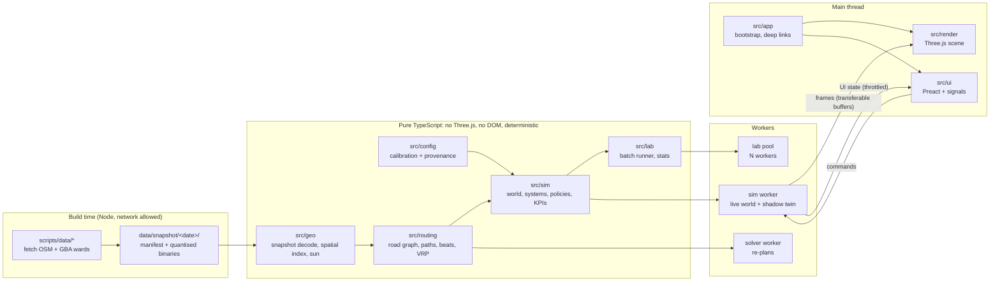

# Swachh Fleet World — Architecture

> Status: **APPROVED 2026-10-14** (Stage 2). **Stage 3 for M1, failing tests: awaiting approval** (§5 lists them).
> Implements `docs/requirements.md` (approved 2026-10-14). Data facts come from `docs/data-sources.md`.
> Decisions are numbered **AD-n**, and each one can be approved or changed separately.

## 1. Overview

The app is one offline HTML file. It has five layers with a strict dependency direction:



**Dependency rule (enforced in AD-2):** `config ← geo ← routing ← sim ← lab`. `render`, `ui` and `app` may import
the pure layers' **types** and pure helpers. The pure layers never import `three`, `preact`, DOM globals, `Date.now`,
`Math.random` or `performance.now`.

## 2. Architecture decisions

### AD-1 Stack and tooling
- **TypeScript 5.x strict** (`strict`, `noUncheckedIndexedAccess`, `exactOptionalPropertyTypes`, `noImplicitOverride`), **no `any`**.
- **Vite** with `vite-plugin-singlefile`. Workers are imported with `?worker&inline`, so they are inlined as blob URLs inside the single file.
- **Three.js** (rendering only), **Preact + @preact/signals** (UI).
- **Vitest** (unit, integration and `bench`), **fast-check** (property tests), **Playwright** (end-to-end against the built `dist/index.html` over `file://`).
- **ESLint** flat config with `typescript-eslint` `strictTypeChecked`, plus Prettier.
- Node 24 LTS. Exact dependency versions are pinned in `package.json` and the committed lockfile. Runtime dependencies are kept to three (`three`, `preact`, `@preact/signals`). Charts are hand-written SVG and validation is hand-written, so there is no chart or schema library.
- Build-time-only dependencies for scripts: `tsx` (to run TS scripts), `proj4` (UTM 43N projection), `@xmldom/xmldom` (to parse the GBA KML). None of them ship in the bundle.
- **Git:** initialised in Stage 3 (2026-10-14), using Conventional Commits.

### AD-2 Module boundaries are enforced, not just documented
- ESLint `no-restricted-imports` and `no-restricted-globals` overrides for `src/{config,geo,routing,sim,lab}/**` ban `three`, `preact*`, `window`, `document`, `Date`, `Math.random` and `performance`.
- A Vitest **architecture test** scans the import graph of the pure folders and fails if any of them reaches a banned module, even through a re-export.
- The pure layers use their own `tsconfig.pure.json` with `"lib": ["ES2022"]` (no `DOM` lib), so DOM types don't even compile there.

### AD-3 Map data pipeline (`scripts/data/`)
`npm run data:fetch` is run by hand and never by the build. It writes `data/snapshot/<YYYY-MM-DD>/`:

| Step | Detail |
|---|---|
| 1. Wards | Download the OpenCity GBA final ward KML (Dec 2025). Keep the 7 cluster wards (config list of `corporation + ward_id`). Cross-check names and numbers against the OSM `admin_level=10` relations, and warn on any mismatch. Extract `TOT_P`. |
| 2. Clip area | Union of the 7 ward polygons plus a **300 m buffer** (streets just outside a ward boundary are still driven), plus a corridor to KCDC (it is already inside ward 69). |
| 3. OSM fetch | Overpass bounding-box queries **in 4 tiles** (area queries time out on public servers, as seen on 2026-10-14). Each tile tries the main server, then the mirrors, with exponential backoff and a polite User-Agent. The raw responses are cached in `.cache/` (git-ignored) so re-runs are offline. |
| 4. Process | Project to UTM 43N (`proj4`), then subtract a fixed local origin (the cluster centroid), so all app coordinates are local metres (x east, y north). Clip to the area. Build the road graph: split ways at junctions, keep `highway` class, `oneway`, `lanes`, `maxspeed`, `name`. Simplify building footprints (Douglas–Peucker, 0.5 m), drop footprints under 12 m², keep `building`, `building:levels`, `height`. Collect water, parks, `amenity=marketplace`, `shop=*` densities, recycling centres and named places. |
| 5. Encode | Coordinates **quantised to 0.25 m in Int16** (±8.19 km range, enough for the ~6 km cluster) and delta-encoded per ring or polyline. Separate files: `roads.bin`, `buildings.bin`, `areas.bin`, plus `wards.json`, `pois.json`. |
| 6. Manifest | `manifest.json`: fetch date, endpoints used, the exact Overpass query texts, bounding boxes, the origin (UTM easting/northing), object counts, a **coverage report** (share of buildings with levels, wards with sparse footprints) and the **SHA-256 of every file**. |

**Expected size:** ~15k buildings × ~8 vertices × 4 B ≈ 0.5 MB, plus roads ≈ 0.4 MB, plus areas ≈ 0.1 MB, so about
**1–1.5 MB after base64**. That is well inside the 15 MB budget (N-1), which resolves risk R-1 without shrinking
the area.

The app imports the snapshot's binaries as base64 strings, which the single-file build inlines. `src/geo/snapshot.ts`
decodes them into typed arrays. P-3: a test recomputes the hashes and compares them with the manifest, so any
hand-edit fails CI.

### AD-4 Coordinates and the sun
- World space is **local metres** in a right-handed frame: x east, y north in the pure layers. The renderer maps this to Three.js (x, −z) with y up. One conversion function is unit-tested.
- The app ships only the origin and a tiny inverse transverse-Mercator function, tested against `proj4` reference points within 1 cm. It turns local metres back into lat/lon for the sun model and, in M5, for imported GPS tracks.
- **Sun position and sunrise/sunset** use the NOAA solar-position algorithm, as a pure function in `src/geo/sun.ts`, checked against published Bengaluru sunrise times for 4 dates (± 2 min).

### AD-5 Simulation core (`src/sim/`)
- **Fixed timestep `dt = 1 s` of simulated time.** The live view advances `speed × realDelta` worth of steps per frame (60× ≈ 60 steps per second, 240× ≈ 240). The step count per frame is capped, so a slow device slows simulated time instead of stuttering.
- **The clock is integer seconds since the scenario's start date at 00:00 IST.** IST is fixed at UTC+5:30 with no DST, so the clock needs no timezone library.
- **Seeded randomness with named streams.** A `xoshiro128**` generator is seeded per stream by hashing `(runSeed, streamName)`: `generation`, `sensors`, `absence`, `breakdown`, `compliance`, `blackspots`, `weather`, `traffic`. Adding a random draw in one system never shifts another system's numbers. Because the live world and the shadow twin share stream seeds, they face the **same** absences, breakdowns and waste. This is the *common random numbers* technique, and it makes KPI deltas reflect the policy rather than the luck of the draw.
- **World state** is plain typed objects in id-indexed arrays (`vehicles[]`, `bins[]`, `segments[]`, `blackSpots[]`, `transferPoints[]`, `facilities[]`), with no classes holding hidden state. It serialises with `structuredClone` for snapshot tests.
- **Systems run in a fixed order each step:** clock → weather → traffic field → generation (lazy) → sensors (every 900 s) → planner hooks (05:00 cut-off, 05:30 publish, incidents) → vehicle behaviour state machines → movement and lane queues → service, tipping, weighing → KCDC intake and diversion → black spots → KPIs → events and alerts.
- **Generation is lazy and analytic.** Each segment and bin stores `(lastServicedAt, accumulatedAtService)`. The current amount is the integral of its daily generation curve × weather and festival multipliers, evaluated in closed form on demand. Nothing ticks for the ~6k segments, and identical results are cheap.
- **Truth vs observation (credibility, R-4).** The sim keeps the **true** fill. Policies receive only an `Observation` (sensor readings with noise, stale or offline sensors, fleet roster, published traffic forecast). The planner function's type has no path to truth, so the dynamic policy cannot cheat.
- **Vehicle behaviour** is an explicit state machine per vehicle type (table in §4). Transitions emit typed events (`StopServed`, `StopSkipped`, `Tipped`, `Weighed`, `Diverted`, `BrokenDown`, …). The UI's process tracker, alerts and KPIs are all computed from this one event stream.
- **Determinism contract:** for the same seed and the same `ScenarioSpec`, the event stream and the final-state hash are identical on the same JS engine. Determinism across browsers isn't promised, because trig results can differ in the last bit. Simulation decisions avoid trig wherever possible.

### AD-6 Movement, traffic and "nothing ever overlaps" (L-4)
There are two tiers:

1. **Fleet vehicles (in the sim, deterministic).** Movement is microscopic along graph edges with **lane queues**: each directed edge has `lanes` FIFO queues. A vehicle keeps a minimum gap (vehicle length + 2 m) behind its leader (a simple Gipps-style speed rule). At junctions, a node **reservation** lets one vehicle at a time hold a junction's conflict area. Priority goes by road class, then arrival time, then vehicle id, so ties break deterministically. A vehicle may not enter an edge whose tail has no room ("don't block the box"), which prevents gridlock. A vehicle stopped for door-to-door service on a two-way street can be passed after a 3 s delay. On a single-lane one-way street, vehicles queue behind it.
2. **Background traffic (macroscopic in the sim, microscopic only in the view).** The sim holds a **density field** per edge from the TomTom-calibrated time-of-day curve × road class × weather, and the field sets fleet vehicle speeds. The renderer spawns visual cars, buses, two-wheelers and autos **only near the camera**, sized to that density. They follow the same gap and junction rules, with fleet vehicles as fixed leaders they must yield to. Visual cars never feed back into the sim, which keeps the sim deterministic and cheap while nothing on screen overlaps.

A property test drives random scenarios and asserts that no two fleet vehicles on the same lane are ever closer than
the minimum gap, and that every junction reservation is released.

### AD-7 Routing (`src/routing/`)
| Part | Design |
|---|---|
| **Road graph** | Compressed sparse row (CSR) adjacency in typed arrays. Directed edges respect `oneway`. Per-edge length, class, lanes and free speed. ~15–20k edges. |
| **Travel time** | Piecewise-constant per **15-minute bucket**: edge time = length ÷ (free speed × class factor × time-of-day factor × weather factor). Plans use the bucket at the planned departure time. Closed edges (waterlogging) have infinite time. |
| **Shortest paths** | Dijkstra with a binary heap. A* (heuristic: straight-line distance ÷ max speed) for point-to-point queries. Many-to-many matrices come from one Dijkstra per source, cached per (bucket, closure set). Contraction hierarchies are deferred unless N-9 fails. |
| **Beats (auto-tippers, arc routing)** | Door-to-door service is **arc routing**: the work is on streets, not points. (1) **Partition** the residential and service segments into *k* contiguous beats of about 1,000 households each (weight = household share by building footprint area × levels). The method is seeded region-growing on the graph, then boundary swaps to balance, and it is deterministic. (2) **Order** each beat's segments as a covering walk: greedy nearest unserved segment with shortest-path connectors, then 2-opt on the segment sequence. One pass serves both sides of a street. |
| **Node VRP (CVRPTW)** | Used for compactor runs (transfer points ↔ KCDC/landfill), market and commercial smart-bin pickups, and black-spot clearance crews. Construction by **Solomon I1 insertion**, then **local search** (relocate, exchange, 2-opt within a route, 2-opt* between routes) with an **iteration budget, not a wall-clock budget**, so results are deterministic. Ties break by stop id. |
| **Static policy** | Beats and compactor schedules are generated once from the network for the default fleet and frozen. Absent vehicles leave their beats unserved (this is today's practice, and it is what makes black spots form). |
| **Dynamic policy** | **05:00 data cut-off → solver worker → plan takes effect at 05:30.** Steps: forecast each bin's and segment's fill at its likely service time (an exponentially smoothed daily profile from observations); choose the required stops (≥ threshold, black-spot risk, the **48 h fairness guard** R-5); re-balance beats across the tippers actually present (absent beats are split among neighbours); solve the node VRP. Incident re-plans (breakdown, closure, new black spot) use the same pattern with a fixed 5-minute sim delay, and they re-plan only the affected routes. |
| **Objective (R-3)** | Lexicographic via weights: overflow-hours and missed black spots ≫ fuel ≫ km. Hard constraints: payload, shift length, transfer-point and KCDC capacity. |
| **Explainability (R-4)** | Every planned stop carries a `reason` (`predictedFill`, `backlogHours`, `blackSpotRisk`, `fairness`). Every dropped candidate carries a `dropReason`. Both appear in the detail panel. |

**Why the result waits for the plan time:** the sim worker sends the 05:00 inputs to the solver worker and keeps
simulating. At 05:30 sim time it applies the plan, and if the solver hasn't answered it **holds the sim clock**
until it does. The result depends only on the 05:00 inputs, so it's deterministic however fast the device is. The
view never freezes (N-9), and tests run the solver inline.

### AD-8 Threads and hosts
- **`SimHost` interface** with two implementations. `WorkerSimHost` (default) and `InlineSimHost` (used by tests, and as a fallback if creating a blob worker from `file://` fails in some browser). Both expose the same typed command and message protocol.
- **Sim worker:** runs the live world **and the shadow twin** (D8) in lockstep, as two independent `World` instances with the same streams. The twin is never rendered. It only feeds KPI deltas.
- **Frames to the view:** after each batch of steps the worker posts a `Frame` carrying a transferable `Float32Array` (per vehicle: x, y, heading, speed, state code, load fraction), the sim time, and any events since the last frame. The renderer keeps the last two frames and **interpolates** at display rate (L-5).
- **UI state:** a separate, throttled message (≤ 4 Hz) carries KPI values and deltas, table rows and alerts into Preact signals. Tables refresh at ≤ 2 Hz.
- **Commands:** `setSpeed`, `pause`, `step`, `skipToMorning`, `setWeather`, `setPolicy`, `applyScenario`, `select(id)` (asks for detailed live state of one object at 4 Hz). All are validated in the worker.
- **Lab pool:** `navigator.hardwareConcurrency − 1` workers (min 1, max 6), each running whole `(spec, seed)` jobs headless with no frames. Results stream back per simulated day.

### AD-9 Calibration config and provenance (P-1 to P-5)
- `src/config/sources.ts` is the registry of `SourceId`s (e.g. `bswml-dh-5500tpd`, `tomtom-2025`, `gba-wards-dec2025`, `osm-snapshot`).
- `src/config/calibration.ts` holds typed figures:
  ```ts
  type Tag = 'real' | 'derived' | 'assumed' | 'synthetic';
  interface Figure<T = number> { readonly value: T; readonly unit: Unit; readonly tag: Tag;
    readonly sourceIds: readonly SourceId[]; readonly asOf: IsoDate; readonly note?: string;
    readonly alternatives?: readonly Figure<T>[] }   // P-4 conflicting values
  ```
- **Derived values are computed, never typed in.** `derive(fn, inputs)` returns a `derived` figure whose `sourceIds` are the union of its inputs'. The W-5 table (population → households → waste → fleet → black spots) is one function of the config, with unit tests.
- **Doc sync test:** Vitest parses `docs/data-sources.md` and fails if any `SourceId` in code is missing from the doc, or if a figure's tag differs from the doc's tag for that source.
- **UI rule (P-2):** every number the UI shows goes through one `<Fig>` component that renders the value, the unit and a tag badge with a tooltip (source and date). Simulated values always show "Simulated". A lint rule bans rendering raw numbers from sim state outside `<Fig>`, via a typed `Provenanced<number>` wrapper.

### AD-10 Rendering (`src/render/`)
| Concern | Design | Draw calls (laptop) |
|---|---|---|
| Buildings | Footprints extruded **in a worker at load time** into merged geometry per **500 m tile × material** (~50 tiles). Low-poly clay material, flat roofs, height from levels or else `assumed` by type and footprint area. Tiles are frustum-culled. The low tier drops the smallest buildings and shadows. | ≤ 60 |
| Roads | Ribbon meshes merged per class (4 classes), with lane markings as a texture in the material. Wet-road reflections come from a roughness and envmap swap in the monsoon. | 6 |
| Ground, water, parks, ward outlines | Merged meshes and one line mesh for wards. | 6 |
| Agents | One `InstancedMesh` per vehicle type (6), bins (by fill colour through instance colour), people, and visual traffic (4 types). | ~15 |
| Facilities | Distinct low-poly models: KCDC, weighbridge, depot, DWCC, transfer points. | ~10 |
| Effects | Rain (instanced streaks), haze (fog), selection ring, route line, trails. | ~6 |

- **Total budget:** under 110 on laptops, under 80 on phones, which leaves headroom under N-2's 200 / 120.
- **Lighting:** one directional sun driven by AD-4 plus hemisphere light. One shadow map fitted to the camera view (2048 on laptop, 1024 on phone, off on the low tier). At night, emissive windows and street lights come from an instanced emissive pass instead of real lights.
- **Quality tiers** (auto-detected from GPU and device memory, overridable): `high` / `medium` / `low`.
- **Picking:** CPU raycast against a spatial hash of agent and facility positions, not mesh raycasts. Clicks under 5 ms.
- **Labels:** one HTML overlay element for the selected object, projected each frame. No per-object DOM.
- **Time scale vs distance (R-3), decision:** short **motion trails** appear at ≥ 120×. **Following a vehicle caps speed at 30×** while following, with a visible "Follow · 30×" badge, and speed returns to the previous value when follow ends.
- `prefers-reduced-motion` turns off eased camera glides (cuts instead), rain streaks and trails.

### AD-11 UI (`src/ui/`)
- Preact components over signals. One `store.ts` maps worker messages to signals, and components never talk to the worker directly (a `commands.ts` façade does).
- The layout follows requirements D-1 to D-9. On phones, panels collapse into a bottom sheet (X-3).
- **Tables** are sorted and filtered in memory. Rows are capped at ~300 (bins 120, fleet ~70, routes ~70), so no virtualisation is needed.
- **Lab charts** are hand-written SVG (bar plus whisker, line with band), each paired with a `<table>` (N-5).
- **Theme:** CSS custom properties. The light/dark choice lives in `localStorage` with try/catch, and failure falls back to dark (X-4).
- **Accessibility:** every panel is reachable by keyboard, focus is visible, and alerts use an `aria-live="polite"` region. The accent #22A86B is used for text only where it passes AA (in dark mode). In light mode it is used only for fills and icons.

### AD-12 Scenarios, deep links and the lab (§7)
- **`ScenarioSpec`** is a plain, versioned JSON object: `{ v: 1, seed, startDate, days, weather, policy, levers: {...}, presetId? }`. A hand-written validator **clamps every lever to its documented range** and rejects unknown keys.
- **Deep link (SC-4):** `#s=<base64url(JSON)>`, capped at 4 KB, decoded only through the validator. Invalid links open the default world with a toast.
- **Lab:** N days × M seeds × 2 configs, spread across the pool. Per-day KPI records are aggregated into mean, standard deviation and a 95% interval across seeds. The ~20% Mumbai figure appears only as a labelled external reference (SC-2).
- **Export (SC-3):** CSV (Blob download) and a printable one-page summary (a print stylesheet on a summary view) listing the spec, the assumptions and every figure's provenance.

### AD-13 Security and privacy
| Risk | Control |
|---|---|
| Runtime network calls (N-6) | A **Content-Security-Policy** meta tag in the built file: `default-src 'none'; script-src 'unsafe-inline' blob:; worker-src blob:; style-src 'unsafe-inline'; img-src data: blob:; font-src data:; connect-src 'none'`. With `connect-src 'none'` the page *cannot* fetch anything, and a Playwright test asserts zero network requests. |
| Untrusted input (deep links now; CSV/JSON import in M5) | Schema validation with size caps (deep link 4 KB, imports 25 MB), numeric clamping, no `eval`/`Function`, no `innerHTML` (Preact escapes text). CSV parsing guards against formula injection on **export** (cells starting with `= + - @` get a leading `'`). |
| Supply chain | Few runtime dependencies (AD-1), a pinned lockfile, `npm audit --omit=dev` in CI, no post-install scripts from new dependencies without review. |
| Data scripts | Run only by hand. Responses are checked (JSON shape, counts within expected ranges) before writing. The snapshot is reviewed in the PR diff (manifest counts). |
| Credibility / misuse (R-5) | Permanent disclaimer (P-5), provenance on every figure, assumptions printed on every export. No logos (N-7). |
| Personal data | None: synthetic IDs only, no plates or names, no telemetry. Imported files stay in memory (IM-2). |

### AD-14 Performance budgets and how they're checked
| Budget | Target | Check |
|---|---|---|
| File size (N-1) | ≤ 15 MB (expected ~3 MB) | Build step fails above the budget |
| Load to first frame | ≤ 4 s on a mid-range laptop | Playwright timing (soft gate) |
| Frame rate (N-2) | 60 fps laptop / ≥ 30 fps phone | Manual check on reference devices plus an in-app FPS overlay (`?debug=1`). CI can't measure GPU fps reliably |
| Draw calls (N-2) | ≤ 200 / ≤ 120 | Playwright reads `renderer.info` via the debug hook and asserts the budget |
| Sim speed | 1 simulated day (live + twin) ≤ 1.5 s headless in Node | `vitest bench` gate |
| Dynamic re-plan (N-9) | ≤ 2 s for the whole cluster | `vitest bench` gate on the solver with the real snapshot |
| Lab | 7 days × 10 seeds × 2 configs ≤ 60 s on 4 workers | Bench (soft gate) |

## 3. Repository layout

Files marked † exist from Stage 3 of M1 (stubs or tests); the rest arrive in later stages and milestones.

```
Swachh-Fleet-World/
├─ CLAUDE.md
├─ docs/                     requirements · architecture · data-sources · (later) import schemas
├─ scripts/data/             fetch-snapshot.ts† · lib/ (overpass.ts†, simplify.ts†, kml.ts†, encode)
├─ data/snapshot/2026-10-xx/ manifest.json · roads.bin · buildings.bin · areas.bin · wards.json · pois.json
├─ src/
│  ├─ shared/   not-implemented.ts† (Stage 3 placeholder, removed when M1 is done)
│  ├─ config/   sources.ts† · calibration.ts† · derive.ts† · scenario.ts† · (M4) scenario validation
│  ├─ geo/      quantise.ts† · snapshot.ts† · project.ts† · spatial-hash.ts† · sun.ts†
│  ├─ routing/  graph.ts† · travel-time.ts† · dijkstra.ts† · beats.ts† · (M3) vrp/ · explain.ts
│  ├─ sim/      rng.ts† · clock.ts† · generation.ts† · sensors.ts† · observation.ts† · events.ts† · kpi.ts† ·
│  │            agents/ (fsm, tipper, compactor, black-spot, crew)† · movement/traffic.ts† · map-data.ts† ·
│  │            world.ts† · world-config.ts† · systems/* · (M3) policies/dynamic.ts
│  ├─ lab/      (M4) runner.ts · stats.ts · export.ts
│  ├─ workers/  sim.worker.ts · solver.worker.ts · lab.worker.ts · protocol.ts · host.ts
│  ├─ render/   coords.ts† · scene.ts · map/ · agents/ · facilities/ · effects/ · camera.ts · picking.ts · quality.ts
│  ├─ ui/       store.ts · commands.ts · components/ (TopBar, KpiCard, DetailPanel, Tracker, Tables, Alerts, DataSources, Lab)
│  └─ app/      main.ts† · debug-api.ts† · deeplink.ts · webgl-check.ts
├─ tests/
│  ├─ fixtures/     grid.ts† · town.ts†
│  ├─ unit/         config† · geo† · routing† · sim† (+ agents†) · render† · scripts†
│  ├─ property/     dijkstra† · beats† · lanes† · (M3) vrp
│  ├─ integration/  day.test.ts†
│  ├─ arch/         boundaries† · provenance-docs† · snapshot-integrity†
│  ├─ perf/         sim-day.perf.test.ts† · (M3) replan.perf.test.ts
│  └─ e2e/          helpers.ts† · offline.spec.ts† · interaction.spec.ts† · (M4) lab.spec.ts
└─ index.html† · vite.config.ts† · vitest.perf.config.ts† · tsconfig.json† · tsconfig.pure.json† · eslint.config.js† · playwright.config.ts† · package.json†
```

npm scripts: `dev`, `build`, `preview`, `lint`, `typecheck` (both tsconfigs), `test` (unit, property, arch,
integration), `test:perf`, `test:e2e`, `data:fetch`, `check` (= lint + typecheck + test).

## 4. Key state machines

| Agent | States (→ transitions on events) |
|---|---|
| Auto-tipper | `OffShift` → `ToBeat` → `Serving(segment)` ⇄ `Driving` → `ToTransfer` (when full or the beat is done) → `Tipping` → back to `ToBeat`, or `ToDepot` → `OffShift`. Side states: `Absent` (whole day), `BrokenDown` (until repair), `Deviating` (non-compliance; geofence emits `RouteDeviation`) |
| Compactor | `OffShift` → `ToTransferPoint` → `Queued` → `Loading` → (full or scheduled) `ToKCDC` → `Weighing` → `Unloading` → next run, or `ToLandfill` (KCDC at cap) → `Unloading` → back |
| Clearance crew | `Idle` → `ToBlackSpot` → `Clearing` (duration ∝ spot size) → `ToKCDC/Landfill` → `Idle` |
| Smart bin | Fill rises continuously. Sensor `Ok` / `Stuck` / `Offline`. A `Serviced` event resets it |
| Black spot | `Dormant` → `Active(size grows)` → `Clearing` → `Dormant`. Activation chance rises with backlog and skips nearby |
| KCDC | Intake counter per day. At the cap, new arrivals are told to divert (event `Diverted`) |

## 5. Test strategy (what Stage 3 writes first)

Stage 3 writes failing tests **for M1 only**. Each later milestone gets its own Stage 3–4 loop under this architecture.

| Suite | First failing tests (M1) |
|---|---|
| `arch/boundaries` | The pure folders import nothing banned |
| `arch/provenance-docs` | Every `SourceId` exists in `data-sources.md` with a matching tag |
| `arch/snapshot-integrity` | Manifest hashes match the files. Counts are within expected ranges |
| `unit/config` | W-5 derivations (population → households → waste → fleet → black spots) give the expected numbers and tags |
| `unit/geo` | Quantise/decode round-trip ≤ 0.125 m error. Inverse projection within 1 cm of `proj4` points. Sunrise and sunset for Bengaluru within 2 min on 4 dates. Spatial hash queries |
| `unit/sim` | RNG streams are independent and reproducible. IST clock formatting. Lazy generation equals step-wise integration. Each state machine's transitions. Event stream. KPI formulas K-1 to K-3 on hand-built worlds |
| `property/*` | Beats: contiguous, every segment in exactly one beat, household balance within ±15%. Lanes: no gap violations, reservations always released, no deadlock in random grids. RNG: uniformity smoke test |
| `unit/routing` | CSR graph from a tiny fixture respects one-ways. Dijkstra and A* match brute force. Time buckets. Closed edges |
| `integration/day` | **Golden determinism:** a seeded static-policy day on a small fixture town gives a fixed event-stream hash. Same seed twice gives identical results. A different seed gives a different result |
| `e2e/offline` | `dist/index.html` opened over `file://` renders a canvas, makes **zero** network requests, shows the OSM attribution and the disclaimer, and shows the WebGL-missing message when WebGL is disabled |
| `e2e/interaction` | Clicking a vehicle selects it (ring, label, panel), and Esc clears the selection |
| `perf/sim-day` | One headless day ≤ 1.5 s (gate) |

VRP tests (known optima on small instances, and property tests for capacity, time windows and each stop served
exactly once) are written in M3's Stage 3.

### 5.1 M1 Stage 3 result (2026-10-14)

**Method.** Every public M1 function exists as a typed stub with its contract in its doc comment. Each stub throws
`NotImplementedError` (`src/shared/not-implemented.ts`), so the tests compile and fail for that one reason. Lint and
both typechecks pass.

| Command | Result |
|---|---|
| `npm run lint`, `npm run typecheck` | Clean |
| `npm test` (unit, property, arch, integration) | **301 tests: 292 fail, 9 pass.** Every failure traces to a stub. The 9 passes are guards that already hold: boundaries (3), the Source IDs table matching the code (3), the type-level truth/observation split (2), and `SpatialHash` rejecting a zero cell size (1) |
| `npm run test:perf` | 1 test, fails (stubs) |
| `npm run test:e2e` (Chromium) | **13 tests: 11 fail, 2 pass.** The 2 passes check the build set-up done in this stage (one `index.html` within budget; CSP with `connect-src 'none'`). Firefox and WebKit need `npx playwright install firefox webkit` |

**Contracts the tests pin down** (beyond §2), so Stage 4 has no guesswork:
- **Fixtures:** `tests/fixtures/grid.ts` is a block grid with every block a separate way. `tests/fixtures/town.ts` is a 6 × 6 town with 60 segments × 60 households, 4 tippers, 2 compactors, 1 crew, 4 market bins and 2 black spots.
- **W-5 formulas** (`deriveClusterScale`): fleets round up, households and black spots round to nearest, and `derivedFrom` is transitive. A fixture calibration gives 156,598 → 250,557 people → 64,245 households → 65 tippers, 98.4 t/day → 6 compactors, 28 black spots.
- **Sun:** published timeanddate.com times for Bengaluru on 1 Mar, 20 Mar, 14 Oct and 21 Dec 2026 (±2 min), and noon altitudes (±0.5°).
- **RNG:** the xoshiro128** reference vector for state [1, 2, 3, 4], independent named streams (including a `layout` stream for map placement), and a chi-square smoke test.
- **Sim time:** a step from t to t+1 emits events stamped t+1. Sensor readings fall at every multiple of 900 s, 96 a day.
- **Speed model:** factor 1 from 23:00 to 05:00, rush-window means equal TomTom ÷ 30 km/h, and adjacent buckets differ by ≤ 0.15.
- **Lane queues:** no same-lane gap violation, a junction reservation held ≤ 60 s, and every vehicle arrives within 120 s + 3 × free-flow time + 600 s on random grids.
- **Beats:** ±15% balance when no segment exceeds 5% of the target, and a walk ≤ 2.5 × the beat's street length on grids.
- **Debug hook** (`src/app/debug-api.ts`, only with `?debug=1`): `ready`, `drawCalls()`, `skipTo()`, `vehicleIds()`, `screenPositionOf()`, `emptyGroundPoint()`, `selectedId()`.
- **The golden event-stream hash** (`integration/day`) is recorded on the first green run and changes only deliberately (`vitest -u`).

## 6. Risks after this design

| # | Risk | Status |
|---|---|---|
| R-1 | Snapshot size | **Resolved by measurement:** ~1–1.5 MB expected (AD-3). |
| R-2 | OSM gaps (heights 1.7% tagged; possible footprint gaps) | Mitigated. Heights `assumed` by rule. The coverage report shows sparse wards in the Data sources dialog. Nothing is invented. |
| R-3 | Time scale vs real distances | Decided: trails ≥ 120× and follow caps at 30× (AD-10). |
| R-4 | Solver credibility | Mitigated. Truth vs observation split (AD-5), sensor noise and forecast error on, common random numbers, multi-seed lab. |
| R-5 | Results quoted as real | Mitigated (AD-13). |
| R-6 *(new)* | Blob workers from `file://` could be blocked in some browser | `InlineSimHost` fallback (AD-8), and Playwright runs on Chromium, Firefox and WebKit. |
| R-7 *(new)* | Public Overpass servers are unreliable (seen 2026-10-14) | Tiled bbox queries, mirrors, backoff, local cache (AD-3). The snapshot is committed, so this only affects re-fetches. |
| R-8 *(new)* | 2026 population projection | The growth factor is `assumed` until sourced in M1. It is a single config lever, and the UI labels it. |
